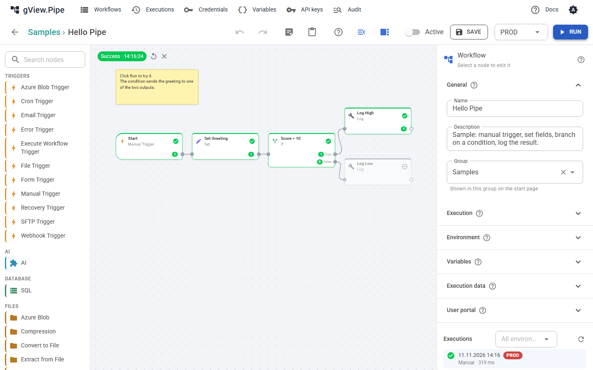
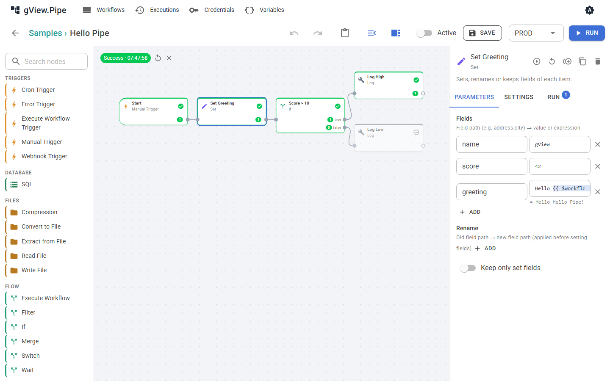
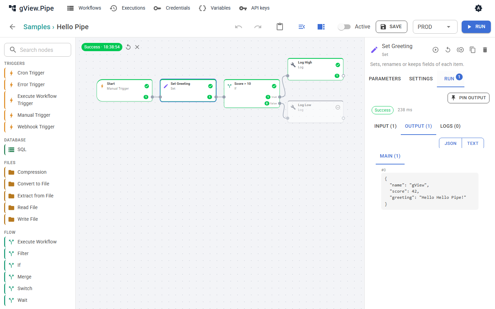
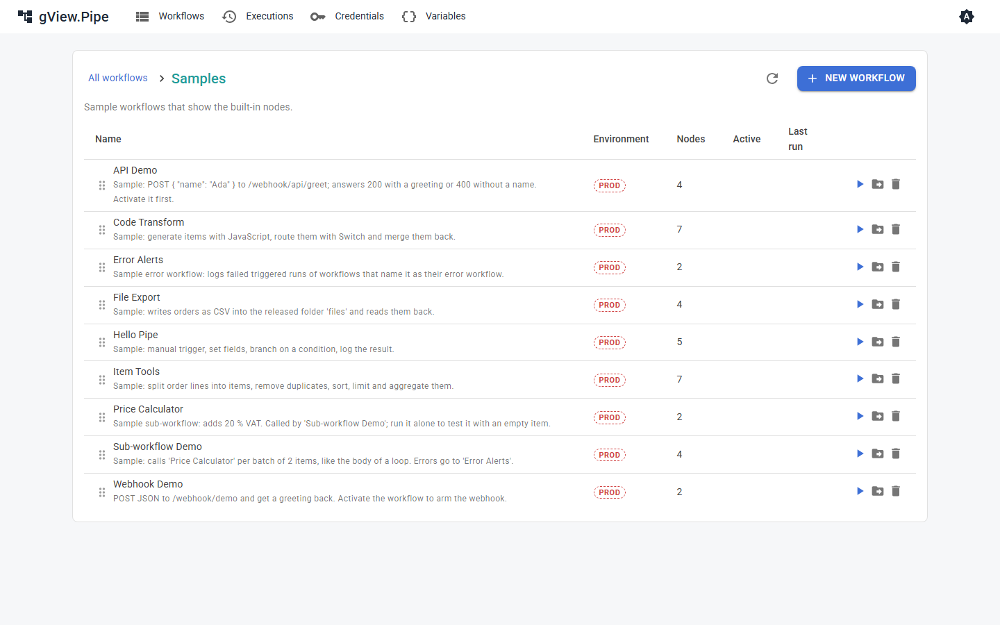

# gView.Pipe

[](CHANGELOG.md)
[](LICENSE)
[](https://dotnet.microsoft.com/download)
[](https://docs.gviewonline.com/other/gview-pipe/index.html)

A workflow automation app in the style of n8n, built on Blazor and .NET 10. Workflows are graphs of nodes that pass JSON items along. A workflow starts manually, on a schedule, through a webhook or from a form. Nodes come from plugins, and the editor is a set of Razor components that other Blazor apps can embed.



## Documentation

**[docs.gviewonline.com/other/gview-pipe](https://docs.gviewonline.com/other/gview-pipe/index.html)**, in English and German:

- [User guide](https://docs.gviewonline.com/other/gview-pipe/user-guide/index.html): the editor, expressions, triggers and webhooks, variables and environments, recipes, and the [node reference](https://docs.gviewonline.com/other/gview-pipe/user-guide/nodes/index.html).
- [Admin guide](https://docs.gviewonline.com/other/gview-pipe/admin-guide/index.html): installation (ZIP, Docker), configuration, sign-in and roles, REST API, command line, user portal, plugins, security and operations.
- [Developer guide](https://docs.gviewonline.com/other/gview-pipe/developer-guide/index.html): writing nodes and plugins, embedding.
- [Release notes](https://docs.gviewonline.com/other/gview-pipe/release-notes.html) and the [changelog](CHANGELOG.md).

The running app serves the same pages under `/docs`. To build them yourself: `./build.cmd Docs` (needs Python, see [CONTRIBUTING.md](CONTRIBUTING.md)). Architecture decisions are in [`docs/adr`](docs/adr), terms in [GLOSSARY.md](GLOSSARY.md).

## Features

- **Build.** A visual editor on a canvas with parameter forms generated from the node classes, undo and redo, copy and paste, sticky notes and Monaco for code fields. Every node shows its input, output and log, live while it runs.
- **Run.** An engine for graphs with parallel branches, retry, timeout and error handling per node. Triggers: manual, cron, webhook (also as a small API) and form. Sub-workflows, error workflows, a queue for triggered runs, failure and recovery notifications.
- **Test quickly.** Pin the output of a node, run up to a node, replay a stored run from a node.
- **Expressions.** `{{ $json.total * 1.2 }}` in any parameter and a Code node, both run in a sandbox (Jint) without access to .NET, files or the network.
- **Configure.** Variables and environments per instance, group and workflow. Credentials are stored encrypted and never appear in the workflow JSON.
- **Operate.** Sign-in (none, forms or OpenID Connect) with the roles viewer, operator, editor and admin. A REST API with API keys, the command line tool `gview-pipe`, an audit log and an execution history.
- **Share.** Publish workflows in the **user portal**, a separate app where users run them through a form and see the result.
- **Extend.** A node is a class implementing `IPipeNode<TParameters>`. Plugins load from a folder, each into its own `AssemblyLoadContext`. Included: SQL (SQL Server, PostgreSQL, SQLite), scripts (bat/cmd, PowerShell, Python, sh) and Excel files.
- **Embed.** The editor and the lists are Razor components for other Blazor apps.
- **Store.** Workflows, groups, executions and credentials are plain JSON files.

| Node parameters | Node result (input, output, logs) | Workflows of a group |
|---|---|---|
|  |  |  |

## Getting started

You need the [.NET 10 SDK](https://dotnet.microsoft.com/download).

```bash
dotnet run --project src/gView.Pipe.Shell
```

Open the URL printed in the console (http://localhost:5240 with the `http` profile). On first start the sample workflows from [`samples/workflows`](samples/workflows) are copied into the group "Samples"; Hello Pipe is the simplest. By default there is no login: switch one on before others can reach the app ([Authentication](https://docs.gviewonline.com/other/gview-pipe/admin-guide/authentication.html)).

Other ways to run it:

- **Aspire.** `dotnet run --project src/Aspire/gView.Pipe.AppHost` starts the Shell and the user portal with the Aspire dashboard (logs, traces, metrics) and optional dev containers; see [CLAUDE.md](CLAUDE.md#dev-containers).
- **Portal.** `dotnet run --project src/gView.Pipe.Portal` after setting `Portal:BackendUrl` and `Portal:ApiKey`; see [User portal](https://docs.gviewonline.com/other/gview-pipe/admin-guide/portal.html).
- **ZIP or Docker.** `./build.cmd Deploy` builds both; for the installation see [Installation](https://docs.gviewonline.com/other/gview-pipe/admin-guide/installation.html).

The settings (`Pipe:*`) live in `src/gView.Pipe.Shell/_config/pipe.config`, created on first start from `_setup/proto/pipe.config` and not in Git. They are listed in [Configuration](https://docs.gviewonline.com/other/gview-pipe/admin-guide/configuration.html).

## Projects

| Project | Purpose |
|---|---|
| `gView.Pipe.Abstraction` | Plugin SDK: contracts, attributes and models. Small and free of UI dependencies, shared by host and plugins. |
| `gView.Pipe.Core` | Headless engine, plugin loader, JavaScript engine, scheduler, trigger manager, file and memory stores. |
| `gView.Pipe.AspNetCore` | ASP.NET Core integration: webhooks, the REST API and the sign-in of the UI. |
| `gView.Pipe.Plugins` | Built-in nodes and credential types. They use only the Abstraction, exactly like external plugins. |
| `gView.Pipe.Plugins.Database`, `.Scripts`, `.Office` | External plugins: SQL, scripts and Excel files. Building one installs it into `src/gView.Pipe.Shell/plugins/`. Install the Scripts plugin only where running scripts is wanted. |
| `gView.Pipe.Razor` | MudBlazor components: workflow list with groups, credential list and the editor. |
| `gView.Pipe.Shell` | The app: layout, routing and service composition. |
| `gView.Pipe.Portal` | The user portal, a standalone Blazor app that runs published workflows through a backend. |
| `gView.Pipe.Cli` | The dotnet tool `gview-pipe`, a client of the REST API. |
| `gView.Pipe.Docs`, `.Docs.Screenshots` | Build tools for the documentation. Not shipped. |
| `Aspire/` | AppHost and ServiceDefaults. |
| `tests/` | xUnit v3 tests, with bUnit for the Razor components. |

### Embedding in another Blazor app

```csharp
builder.Services
    .AddPipeCore()
    .AddPipeFileStore(options => options.RootPath = "data")
    .AddPipeRazor();

// ...
app.MapPipeWebhooks();
```

The host must reference the MudBlazor and Z.Blazor.Diagrams CSS/JS plus `_content/gView.Pipe.Razor/css/gview-pipe.css` and render the components interactively without prerendering. See [`App.razor`](src/gView.Pipe.Shell/Components/App.razor) and [ADR 0004](docs/adr/0004-ui-mudblazor-diagrams.md).

## Writing a node

Reference `gView.Pipe.Abstraction`, describe the parameters as a POCO and implement the node:

```csharp
public sealed class UppercaseParameters
{
    [PipeParameter(Label = "Field", Placeholder = "name")]
    public string Field { get; set; } = "name";
}

[PipeNode("0d6f3c1e-8a52-4f0b-9b7e-3c2a1d4e5f60", "Uppercase",
    Category = "Transform", Description = "Converts a text field to upper case.")]
public sealed class UppercaseNode : PipeItemNodeBase<UppercaseParameters>
{
    protected override Task<PipeItem?> ProcessItemAsync(PipeItem item, UppercaseParameters parameters,
        IPipeNodeContext context, CancellationToken cancellationToken)
    {
        var result = item.Clone();
        if (result.Json[parameters.Field]?.GetValue<string>() is { } text)
        {
            result.Json[parameters.Field] = text.ToUpperInvariant();
        }
        return Task.FromResult<PipeItem?>(result);
    }
}
```

The GUID identifies the node type in saved workflows and must never change. Triggers, several outputs, dynamic ports, migrations and packaging a plugin are in the [developer guide](https://docs.gviewonline.com/other/gview-pipe/developer-guide/index.html); the built-in nodes in [`src/gView.Pipe.Plugins`](src/gView.Pipe.Plugins) are working examples.

## Development

```bash
dotnet build gView.Pipe.slnx
dotnet test --solution gView.Pipe.slnx
```

Tests run on Microsoft.Testing.Platform (see `global.json`). The sample workflows are executed by the plugin tests, so a broken sample fails the build. How to contribute: [CONTRIBUTING.md](CONTRIBUTING.md). Security issues: [SECURITY.md](SECURITY.md).

## License

[Apache License 2.0](LICENSE). Third-party components and their licenses are listed in [THIRD-PARTY-NOTICES.md](THIRD-PARTY-NOTICES.md).
