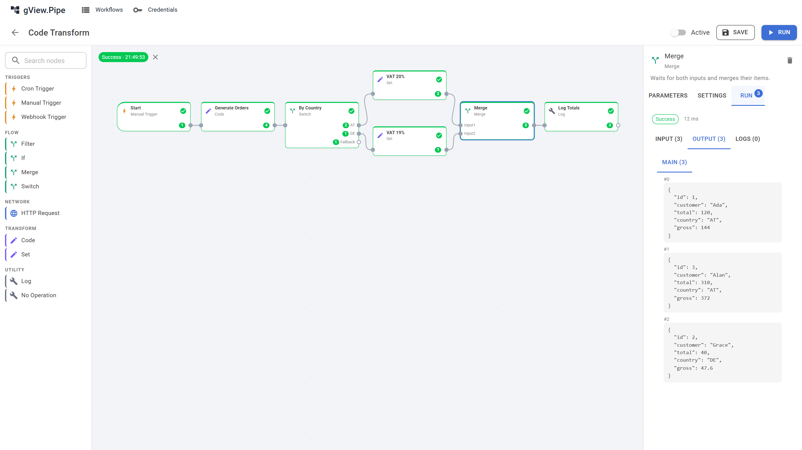
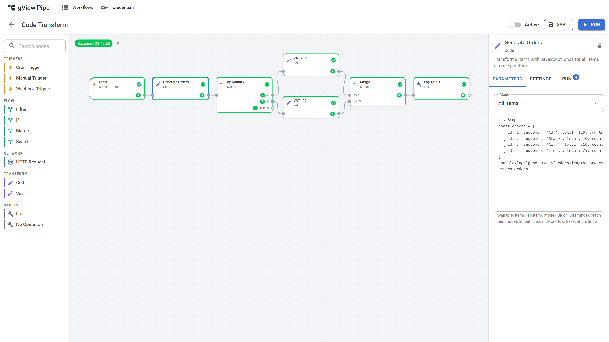
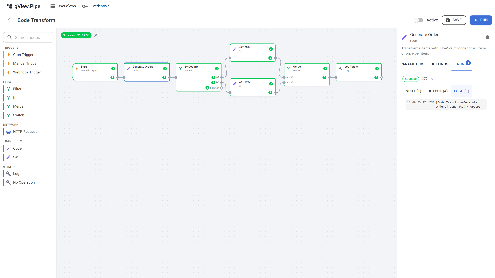
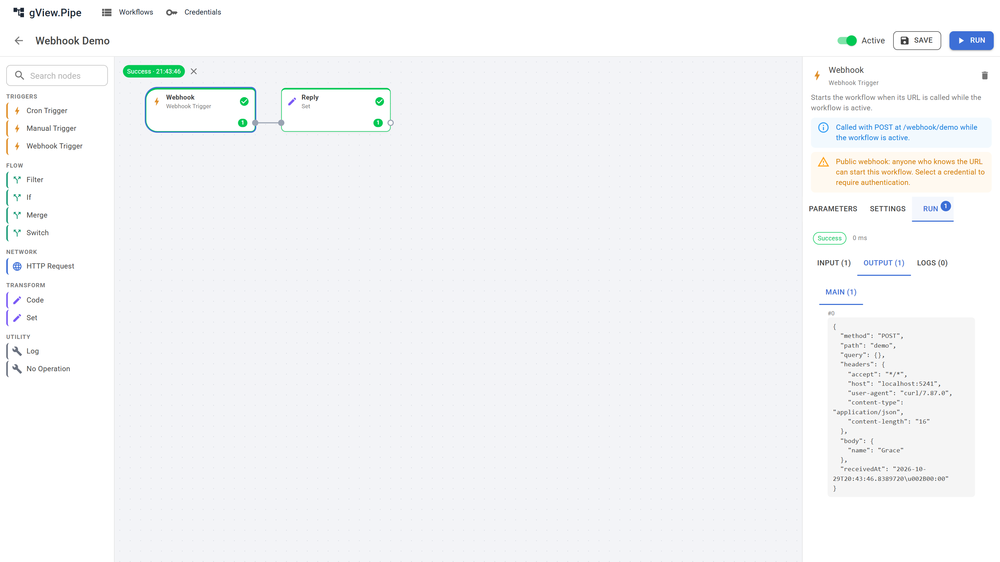
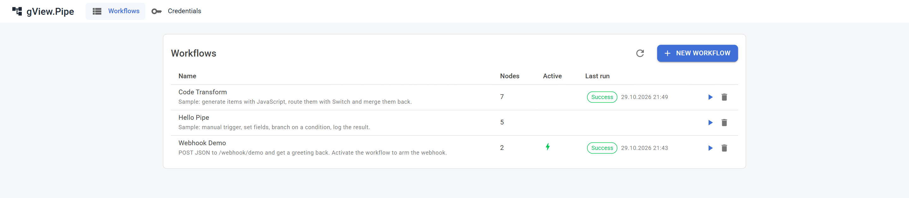

# gView.Pipe

A workflow automation app in the style of n8n, built on Blazor and .NET 10. Workflows are graphs of nodes that pass JSON items along. A workflow starts manually, on a schedule or through a webhook. Nodes come from plugins, and the editor is a set of Razor components that other Blazor apps can embed.



## Features

- **Visual editor.** Build workflows on a canvas (Z.Blazor.Diagrams) with a node palette and parameter forms generated from the node's parameter class (MudBlazor).
- **Execution engine.** Runs the graph as a DAG. Parallel branches, Switch/If/Merge, retry, timeout and error handling per node (stop, continue or route to an error output).
- **Inspect every node.** Each node shows the input it received, the output it produced and the log entries it wrote, for the latest run and for any execution in the history. Click a property of the input to insert it as an expression into the parameter you edited last. Items can be shown as JSON or as text (field as heading, value as paragraph, line breaks kept), and what a node logs while it runs (e.g. a script's output) streams live into the side panel.
- **Fast iteration.** Pin a node's output so manual runs reuse it instead of calling the API again, run only up to a node ("run to here"), duplicate nodes and copy/paste them (Ctrl+C / Ctrl+V on the canvas) within or between workflows. Hold Shift while dragging a node onto a connection to insert it there; the connection lights up before you drop. Undo and redo every change to the workflow (Ctrl+Z / Ctrl+Y on the canvas, or the toolbar). The palette and the side panel can be resized; a wide palette shows its nodes in columns.
- **JavaScript expressions.** `{{ $json.total * 1.2 }}` in any parameter, plus a Code node for larger transformations. Both run in a sandboxed Jint engine.
- **Triggers.** Manual, Cron and Webhook.
- **Credentials.** Stored encrypted with ASP.NET Data Protection. Nodes reference them by id and never see them in the workflow JSON.
- **Plugins.** A node is a class implementing `IPipeNode<TParameters>`. External plugins are loaded from a folder, each into its own `AssemblyLoadContext`.
- **Groups.** Workflows can be put into groups, shown as tiles on the start page; drag a workflow onto a tile to move it. A search finds workflows in all groups.
- **Storage.** Workflows, groups, executions and credentials are plain JSON files.

| Code node | Node logs | Webhook request as input |
|---|---|---|
|  |  |  |



## Getting started

You need the [.NET 10 SDK](https://dotnet.microsoft.com/download).

```bash
dotnet run --project src/gView.Pipe.Shell
```

Open the URL printed in the console (http://localhost:5240 with the `http` profile). On first start, the sample workflows from [`samples/workflows`](samples/workflows) are copied into the empty store, in the group "Samples":

- **Hello Pipe**: a manual trigger, Set and Log.
- **Code Transform**: generates orders with JavaScript, routes them by country with Switch, adds VAT and merges them again.
- **Item Tools**: splits order lines into items, removes duplicate SKUs, sorts by price, keeps the top 3 and collects them.
- **Sub-workflow Demo** and **Price Calculator**: a workflow calling another one per batch of two items; failures go to **Error Alerts**, an error workflow.
- **API Demo**: `POST /webhook/api/greet` answers 200 with a greeting, or 400 without a name, through Respond to Webhook nodes.
- **File Export**: writes orders as CSV into the folder `files` and reads them back.
- **Webhook Demo**: answers `POST /webhook/demo` with a greeting. It is inactive until you switch it on.

To run the Shell with the Aspire dashboard (logs, traces, metrics):

```bash
dotnet run --project src/Aspire/gView.Pipe.AppHost
```

### Configuration

`src/gView.Pipe.Shell/appsettings.json`:

| Key | Default | Meaning |
|---|---|---|
| `Pipe:DataPath` | `data` | Folder for `workflows/`, `groups.json`, `executions/`, `credentials/` and the Data Protection `keys/`. |
| `Pipe:PluginPath` | `plugins` | Folder with external plugins, one sub folder per plugin: `plugins/<Name>/<Name>.dll`. |
| `Pipe:FileRoots` | `files` → `files` | Folders Read File and Write File may use, by name. Nothing outside them is reachable. |
| `Pipe:Scripts` | `ScriptRoots`: `scripts` → `scripts` | Script folders and Git repositories (`Repositories`: `Url`, `Branch`, `CredentialId`) Run Scripts may use, plus `Interpreters` and `GitPath`. See ADR 0011. |

The Wait node waits at most one hour; change it with `services.Configure<PipeWaitOptions>(o => o.MaxWait = …)`. Further options (execution retention, script limits, binary thresholds) are on `PipeCoreOptions` and `PipeFileStoreOptions` and can be set in `Program.cs`.

## Projects

| Project | Purpose |
|---|---|
| `gView.Pipe.Abstraction` | Plugin SDK: contracts, attributes and models. Small and free of UI dependencies, shared by host and plugins. |
| `gView.Pipe.Core` | Headless engine, plugin loader, JavaScript engine, scheduler, trigger manager, file and memory stores. |
| `gView.Pipe.AspNetCore` | ASP.NET Core integration: `app.MapPipeWebhooks()`. |
| `gView.Pipe.Plugins` | Built-in nodes and credential types. They use only the Abstraction, exactly like external plugins. |
| `gView.Pipe.Plugins.Scripts` | Run Scripts node: batch, PowerShell, Python and shell scripts from released folders or Git repositories. An external plugin; install it only where running scripts is wanted. |
| `gView.Pipe.Plugins.Database` | SQL node for SQL Server, PostgreSQL and SQLite. An external plugin: building it installs it into `src/gView.Pipe.Shell/plugins/`. |
| `gView.Pipe.Razor` | MudBlazor components: workflow list with groups, credential list and the editor. |
| `gView.Pipe.Shell` | The app: layout, routing and service composition. |
| `Aspire/` | AppHost and ServiceDefaults. |
| `tests/` | xUnit v3 tests for Core, Plugins, the database plugin and the Razor components (bUnit). |

### Embedding in another Blazor app

```csharp
builder.Services
    .AddPipeCore()
    .AddPipeFileStore(options => options.RootPath = "data")
    .AddPipeRazor();

// ...
app.MapPipeWebhooks();
```

The host must reference the MudBlazor and Z.Blazor.Diagrams CSS/JS plus `_content/gView.Pipe.Razor/css/gview-pipe.css`, and render the components interactively without prerendering. See [`App.razor`](src/gView.Pipe.Shell/Components/App.razor) and [ADR 0004](docs/adr/0004-ui-mudblazor-diagrams.md).

## Built-in nodes

| Category | Nodes |
|---|---|
| Triggers | Manual Trigger, Cron Trigger, Webhook Trigger, Execute Workflow Trigger, Error Trigger |
| Flow | If, Switch, Filter, Merge, Wait, Execute Workflow |
| Transform | Set, Code, Sort, Limit, Aggregate, Split Out, Remove Duplicates |
| Network | HTTP Request, Respond to Webhook, Send Email |
| Files | Read File, Write File |
| Database (plugin) | SQL |
| Scripts (plugin) | Run Scripts |
| Utility | Log, No Operation |

Credential types: Basic Auth, Bearer Token, API Key Header, Connection String and SMTP.

- **Read File / Write File** work only inside folders the host releases (`Pipe:FileRoots`); a node names the folder and a path relative to it. Formats: binary attachment, text, JSON and CSV.
- **SQL** (`gView.Pipe.Plugins.Database`) runs a query or statement per input item over a Connection String credential (provider `sqlserver`, `postgres` or `sqlite`). Values go in as `@name` parameters only; the SQL text itself is never evaluated as an expression.
- **Send Email** sends one mail per item over SMTP (MailKit), optionally with the item's attachments.
- **Run Scripts** (`gView.Pipe.Plugins.Scripts`) runs `.bat`/`.cmd`, `.ps1`, `.py` or `.sh` files from a released script folder or a configured Git repository (needs git installed). The parameters list the scripts found; switch them on and order them. Each runs in its own process; a non-zero exit code or an output line matching the error pattern fails it. Scripts run with the rights of the host process.

## Sub-workflows and error workflows

- **Execute Workflow** runs another workflow that starts with an **Execute Workflow Trigger**: once for all items, per item, or per batch of N items. It outputs what the sub-workflow's last node returned. Calling per item or batch is how loops are built; the engine itself only runs graphs without cycles. Sub-workflows share the caller's binaries and may be nested up to 10 levels.
- An **error workflow** is chosen in the workflow panel. It starts with an **Error Trigger** and runs when a triggered run (cron, webhook, sub-workflow call) fails, with `{ workflow, execution, node }` of the failed run, e.g. to send a notification.

## Expressions

Every string parameter can contain `{{ … }}` blocks with JavaScript. A parameter that consists of a single block keeps the type of the result (number, object, array); otherwise the results are inserted into the text.

```text
Hello {{ $json.customer }}!
{{ Math.round($json.total * 1.2 * 100) / 100 }}
{{ $node["Generate Orders"].all.length }}
```

| Variable | Value |
|---|---|
| `$json` | JSON of the current item |
| `$itemIndex` | Index of the current item |
| `$input.all()`, `$input.first()` | All items of the node's input |
| `$node["Name"].json`, `$node["Name"].all` | Output of an earlier node |
| `$workflow`, `$execution` | Information about the workflow and the running execution |
| `$now` | Current time as ISO string |

The **Code** node runs a script either once for all items (`items` holds them, return an array) or once per item (`$json`, return an object). `console.log` writes to the node's logs.

```js
// items: the JSON of all input items
return items
  .filter(order => order.total > 50)
  .map(order => ({ ...order, priority: order.total > 200 }));
```

Scripts run with no access to .NET, the file system or the network, and are limited in time, memory, statements and recursion (`PipeCoreOptions.Scripts`). See [ADR 0007](docs/adr/0007-javascript-expressions.md).

## Webhooks

A Webhook Trigger listens on `/webhook/{path}`. The path is unique across all workflows, and the webhook is armed only while its workflow is active. The request becomes an item with `method`, `path`, `query`, `headers` and `body`; uploaded files become binaries. The `Authorization` and `Cookie` headers are stripped. Optionally the trigger checks a credential.

With response mode **When finished**, the caller gets the output of the last node. With **Immediately**, the caller gets `202 Accepted` and the execution id. With **Using respond node**, a **Respond to Webhook** node decides status code, headers and body, so a workflow can act as a small API (see the API Demo sample).

With the Webhook Demo workflow active:

```bash
curl -X POST http://localhost:5240/webhook/demo -H "Content-Type: application/json" -d '{"name":"Ada"}'
```

PowerShell:

```powershell
Invoke-RestMethod -Method Post -Uri http://localhost:5240/webhook/demo -ContentType "application/json" -Body '{"name":"Ada"}'
```

See [ADR 0008](docs/adr/0008-webhooks.md) for status codes and limits.

## Writing a node

Reference `gView.Pipe.Abstraction`, describe the parameters as a POCO and implement the node:

```csharp
using gView.Pipe.Abstraction.Data;
using gView.Pipe.Abstraction.Nodes;
using Microsoft.Extensions.Logging;

namespace MyCompany.Pipe.Nodes;

public sealed class UppercaseParameters
{
    [PipeParameter(Label = "Field", Placeholder = "name")]
    public string Field { get; set; } = "name";
}

[PipeNode("0d6f3c1e-8a52-4f0b-9b7e-3c2a1d4e5f60", "Uppercase",
    Category = "Transform",
    Description = "Converts a text field to upper case.")]
public sealed class UppercaseNode : PipeItemNodeBase<UppercaseParameters>
{
    protected override Task<PipeItem?> ProcessItemAsync(PipeItem item, UppercaseParameters parameters,
        IPipeNodeContext context, CancellationToken cancellationToken)
    {
        var result = item.Clone();
        if (result.Json[parameters.Field]?.GetValue<string>() is { } text)
        {
            result.Json[parameters.Field] = text.ToUpperInvariant();
        }
        context.Logger.LogInformation("Converted {Field}", parameters.Field);

        return Task.FromResult<PipeItem?>(result);
    }
}
```

- The GUID in `[PipeNode]` identifies the node type in saved workflows. Never change it.
- Parameter values are evaluated per item, so `Field` may itself be an expression.
- For several outputs, triggers, dynamic ports or parameter migrations, see the built-in nodes in [`src/gView.Pipe.Plugins`](src/gView.Pipe.Plugins) and [CLAUDE.md](CLAUDE.md#writing-a-node).

Build the plugin and copy the output to `plugins/MyCompany.Pipe/MyCompany.Pipe.dll` next to the Shell. Don't ship `gView.Pipe.Abstraction.dll` or `Microsoft.Extensions.*` with it; these always come from the host.

## Development

```bash
dotnet build gView.Pipe.slnx
dotnet test --solution gView.Pipe.slnx
```

Tests run on Microsoft.Testing.Platform (see `global.json`). The sample workflows are executed by the plugin tests, so a broken sample fails the build.

Terms are defined in [GLOSSARY.md](GLOSSARY.md), design decisions are in [docs/adr](docs/adr).

## License

[Apache License 2.0](LICENSE). Third-party components and their licenses are listed in [THIRD-PARTY-NOTICES.md](THIRD-PARTY-NOTICES.md).
