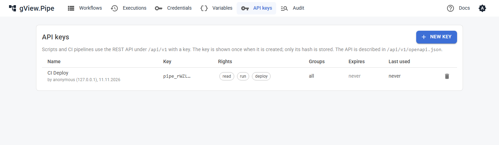

# REST API

Skripte und CI-Pipelines nutzen die REST API unter `/api/v1`, um Workflows auszuführen, Executions abzufragen und Workflows zu deployen. Die API hat eigene Schlüssel; die Anmeldung der UI nutzt sie nie.

## API-Schlüssel

Schlüssel legst du auf der Seite **API keys** an (Navigation). Ein Schlüssel hat:

| Einstellung | Bedeutung |
|---|---|
| Name | Wer oder was ihn nutzt, z. B. `CI Deploy`. Mit dem Schlüssel gestartete Läufe zeigen in der Historie `API · CI Deploy`. |
| Rights | **Read**: Workflows, Executions, Gruppen. **Run**: Läufe starten, stoppen, wiederholen. **Deploy**: Workflows anlegen, ändern, löschen, aktivieren. **Portal**: nur die [Portal-Endpunkte](#portal-endpunkte) für das Anwender-Portal; allein verwenden. |
| Only these groups | Beschränkt den Schlüssel auf die Workflows dieser Gruppen. Andere Workflows sieht er gar nicht, auch keine ohne Gruppe. |
| Expires | Nach diesem Tag wird der Schlüssel abgelehnt. Leer: nie. |



Der Schlüssel (`pipe_…`) wird **einmal** angezeigt, beim Anlegen. Gespeichert wird nur sein SHA-256 (`data/api-keys.json`); ein verlorener Schlüssel lässt sich also nicht mehr anzeigen: Lösche ihn und lege einen neuen an. Am Präfix `pipe_` erkennen Secret-Scanner, z. B. von GitHub, versehentlich eingecheckte Schlüssel.

Schicke den Schlüssel als Header:

```
X-Pipe-Api-Key: pipe_…
```

oder als `Authorization: Bearer pipe_…`.

!!! warning
    Nur Benutzer mit der [Rolle](authentication.md#rollen) admin können Schlüssel anlegen. Mit `Pipe:Auth:Mode` *none* ist jeder admin, der die UI erreicht. Schütze die UI mit einer [Anmeldung](authentication.md), bevor du dich auf Schlüssel verlässt. Mehr als 60 Fehlversuche pro Minute von einer Adresse werden mit `429` beantwortet.

## Endpunkte

Die API ist in `/api/v1/openapi.json` (OpenAPI 3) beschrieben. Lade die Datei in ein Werkzeug deiner Wahl, z. B. Postman, Bruno oder einen OpenAPI-Viewer, um die Endpunkte auszuprobieren.

| Methode und Pfad | Recht | Macht |
|---|---|---|
| `GET /api/v1/workflows` | read | Listet die Workflows. |
| `GET /api/v1/workflows/{id}` | read | Der Workflow als JSON, mit seiner Version als `ETag`. |
| `PUT /api/v1/workflows/{id}` | deploy | Legt den Workflow an oder ersetzt ihn (siehe unten). |
| `DELETE /api/v1/workflows/{id}` | deploy | Löscht den Workflow. |
| `POST /api/v1/workflows/{id}/activate`, `/deactivate` | deploy | Schaltet seine Trigger ein oder aus. |
| `POST /api/v1/workflows/{id}/run` | run | Startet einen Lauf (siehe unten). |
| `GET /api/v1/executions` | read | Executions, die neueste zuerst. Filter: `workflowId`, `status`, `mode`, `from`, `before`, `limit`. |
| `GET /api/v1/executions/{workflowId}/{id}` | read | Eine Execution mit Eingabe, Ausgabe und Logs jedes Nodes. |
| `POST /api/v1/executions/{workflowId}/{id}/cancel` | run | Stoppt einen laufenden oder wartenden Lauf. |
| `POST /api/v1/executions/{workflowId}/{id}/replay` | run | Führt die Execution erneut aus; Body `{ "fromNodeId": "…" }`, um an einem Node zu beginnen ([Replay](../user-guide/executions.md#replay)). |
| `GET /api/v1/groups` | read | Listet die Workflow-Gruppen. |
| `GET /api/v1/audit` | read | Das [Audit-Log](operations.md#audit-log), die neuesten zuerst. Filter: `from`, `before`, `actor`, `area`, `objectId`, `limit`. Nur für Schlüssel ohne Gruppen-Beschränkung. |

Fehler werden als `application/problem+json` beantwortet, mit einem `title`, der sagt, was nicht stimmt.

## Einen Workflow ausführen

```
POST /api/v1/workflows/{id}/run
{ "items": [ { "name": "Ada" } ], "environment": "TEST", "wait": true, "timeoutSeconds": 30 }
```

Alle Felder sind optional. Der Lauf startet an allen Nodes ohne eingehende Verbindung, mit `items` als deren Eingabe (Vorgabe: ein leeres Item). Er verhält sich wie ein getriggerter Lauf: Angeheftete Daten werden ignoriert, der [Fehler-Workflow](../user-guide/error-handling.md#fehler-workflows) startet bei einem Fehler, und die Warteschlange des Workflows gilt ([Max queued runs](../user-guide/editor.md#einstellungen-des-workflows)).

| Antwort | Wann |
|---|---|
| `200` `{ executionId, status, error, errorNode, node, items }` | `wait` und der Lauf endete rechtzeitig; `items` ist die Ausgabe des zuletzt beendeten Nodes. Auch ein fehlgeschlagener Lauf ist `200`, mit `status: "error"`. |
| `202` `{ executionId, status }` | Ohne `wait`, oder der Lauf dauert länger als `timeoutSeconds`; frag später `GET /executions/{workflowId}/{executionId}`. |
| `429` | Der Workflow läuft schon, und seine Warteschlange ist voll. |

## Einen Workflow deployen

`PUT /api/v1/workflows/{id}` nimmt das JSON eines Workflows, wie `GET` es liefert oder wie es in `data/workflows` liegt. Vor dem Speichern wird geprüft: eindeutige Node-Ids und -Namen, Verbindungen zwischen vorhandenen Nodes, keine Zyklen, installierte Node-Typen, gültige Parameter. Probleme werden mit `422` und einer Liste in `details.errors` beantwortet. Credentials, die es auf diesem Server nicht gibt, stehen als `details.warnings` in der Antwort, sind aber keine Fehler.

Schicke `If-Match` mit dem `ETag` eines `GET`, um sicherzugehen, dass niemand den Workflow zwischendurch geändert hat; sonst bekommst du `412`. Ohne `If-Match` wird der Workflow ersetzt. Ist der Workflow aktiv, werden seine Trigger mit der neuen Version neu geladen.

## Beispiele

=== "curl"

    ```bash
    KEY=pipe_...
    # ausführen und auf das Ergebnis warten
    curl -s -X POST https://pipe.example.com/api/v1/workflows/hello-pipe/run \
      -H "X-Pipe-Api-Key: $KEY" -H "Content-Type: application/json" \
      -d '{ "items": [ { "name": "Ada" } ], "wait": true }'

    # einen Workflow aus einer Datei deployen
    curl -s -X PUT https://pipe.example.com/api/v1/workflows/hello-pipe \
      -H "X-Pipe-Api-Key: $KEY" -H "Content-Type: application/json" \
      --data-binary @hello-pipe.json

    # die letzten fehlgeschlagenen Läufe
    curl -s "https://pipe.example.com/api/v1/executions?status=error&limit=10" -H "X-Pipe-Api-Key: $KEY"
    ```

=== "PowerShell"

    ```powershell
    $headers = @{ "X-Pipe-Api-Key" = "pipe_..." }
    # ausführen und auf das Ergebnis warten
    $body = @{ items = @(@{ name = "Ada" }); wait = $true } | ConvertTo-Json -Depth 5
    Invoke-RestMethod -Method Post -Uri https://pipe.example.com/api/v1/workflows/hello-pipe/run `
      -Headers $headers -ContentType "application/json" -Body $body

    # einen Workflow aus einer Datei deployen
    Invoke-RestMethod -Method Put -Uri https://pipe.example.com/api/v1/workflows/hello-pipe `
      -Headers $headers -ContentType "application/json" -InFile hello-pipe.json

    # die letzten fehlgeschlagenen Läufe
    Invoke-RestMethod -Uri "https://pipe.example.com/api/v1/executions?status=error&limit=10" -Headers $headers
    ```

Credentials, Variablen und Gruppen lassen sich über die API nicht ändern; richte sie in der UI ein.

## Portal-Endpunkte

Für das Anwender-Portal (Anwender, die Workflows ausführen, aber nicht bearbeiten) erreicht ein Key mit dem Recht **Portal** nur `/api/v1/portal`. Er kann nichts anderes, und kein anderer Key erreicht diese Endpunkte. Jede Anfrage nennt den Anwender, für den sie gilt, im Header `X-Pipe-On-Behalf-Of`; Läufe zeigen `portal:<Anwender>` als Starter, und Anwender sehen und stoppen nur ihre eigenen Läufe. Der Portal-Server wird darin als vertrauenswürdig behandelt, dass er den richtigen Anwender nennt. Halte den Key deshalb auf diesem Server und lass nur ihn das Backend erreichen.

| Methode und Pfad | Macht |
|---|---|
| `GET /api/v1/portal/workflows` | Die veröffentlichten Workflows mit Kategorie, Formular und Einstellungen zum Lauf. |
| `POST /api/v1/portal/workflows/{id}/run` | Startet einen Lauf. Body `{ "values": { … }, "mode": "wait" oder "background" }`. Die Werte werden gegen das Formular geprüft (`422` mit den falschen Feldern). Beim Warten kommt das Ergebnis zurück, oder `202`, wenn das Warte-Timeout abgelaufen ist. |
| `GET /api/v1/portal/executions` | Die Läufe des Anwenders, neueste zuerst, auch die laufenden. |
| `GET /api/v1/portal/executions/{workflowId}/{id}` | Status und Ergebnis eines Laufs des Anwenders. |
| `POST /api/v1/portal/executions/{workflowId}/{id}/cancel` | Stoppt einen Lauf des Anwenders, falls der Workflow das nicht verbietet. |

Welche Workflows erscheinen, stellst du in den [Workflow-Einstellungen](../user-guide/editor.md#einstellungen-des-workflows) ein: Sichtbar sind nur Workflows mit *Publish in portal*, in der Kategorie ihrer Gruppe. Der Form Trigger legt das Formular fest, der Result-Node, was der Anwender am Ende sieht. Anwender sehen nie rohe Items oder Fehlerdetails der Nodes: Ein fehlgeschlagener Lauf zeigt die *Error message* des Result-Nodes oder einen allgemeinen Text mit der Nummer des Laufs.

Jedes Feld des Formulars hat einen Namen, einen Typ (Text, mehrzeiliger Text, Zahl, Ja/Nein, Datum, Auswahl, Passwort), ein Label, eine Beschreibung, einen Platzhalter, einen Standardwert und *Required*. Textfelder können ein **Muster** haben, einen regulären Ausdruck, auf den der Text als Ganzes passen muss (z. B. `[A-Z]{1,2}-\d{1,5}`), mit der Meldung, die sonst erscheint. Das Portal kann es schon beim Tippen prüfen; das Backend prüft es bei jedem Start nochmal. Beschränke Muster auf das, was .NET und JavaScript gemeinsam verstehen.

Ein Anwender darf `Pipe:Portal:MaxRunsPerUser` Läufe gleichzeitig haben (Standard 3, 0 = unbegrenzt); weitere beantwortet das Backend mit `429`.
