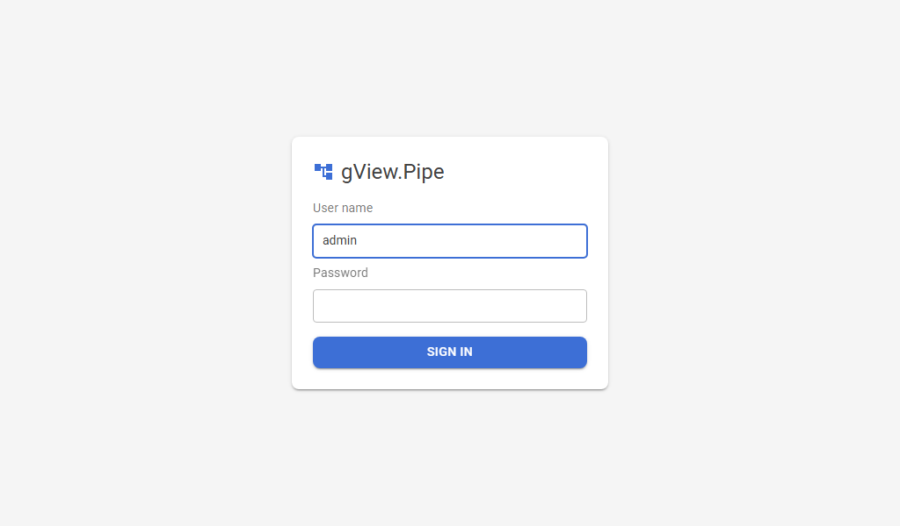

# Anmeldung

gView.Pipe kennt drei Anmeldemodi. Du wählst einen pro Instanz in `_config/auth.config`:

| Modus | Bedeutung |
|---|---|
| `none` | Keine Anmeldung (Vorgabe). Jeder, der die Adresse erreicht, darf die App benutzen. Nur auf `localhost` oder in einem geschützten Netz verwenden. |
| `forms` | Ein Anmeldeformular mit Benutzern aus der Konfiguration. |
| `oidc` | Anmeldung bei einem Identity Provider mit OpenID Connect, zum Beispiel IdentityServer.NET. |

Die Anmeldung schützt die Oberfläche. **Webhooks** und die **Dokumentation** unter `/docs` bleiben ohne Anmeldung erreichbar; schütze Webhooks mit einem Credential (siehe [Sicherheit](security.md#webhooks)). Wer angemeldet ist, darf alles.

## Die Datei auth.config

Beim ersten Start legt die App `_config/auth.config` aus der Vorlage `_setup/proto/auth.config` an, neben `pipe.config` (siehe [Konfiguration](configuration.md)). Umgebungsvariablen überschreiben sie, zum Beispiel `Pipe__Auth__Mode=forms`.

| Einstellung | Vorgabe | Bedeutung |
|---|---|---|
| `Pipe:Auth:Mode` | `none` | `none`, `forms` oder `oidc`. |
| `Pipe:Auth:SessionMinutes` | `480` | Minuten ohne Anfrage, bis die Anmeldung abläuft. Jede Anfrage verlängert sie. |
| `Pipe:Auth:UseForwardedHeaders` | `false` | Den Headern `X-Forwarded-For/-Proto/-Host` eines Reverse Proxys vertrauen. Nötig für OIDC hinter einem Proxy, der https beendet. |
| `Pipe:Auth:Users` | | Benutzer des Modus `forms`, siehe unten. |
| `Pipe:Auth:LoginAttemptsPerMinute` | `10` | Anmeldeversuche pro Minute und Client-Adresse; weitere werden mit 429 beantwortet. |
| `Pipe:Auth:Oidc:*` | | Einstellungen des Modus `oidc`, siehe unten. |

## Forms: feste Benutzer



```json
{
  "Pipe": {
    "Auth": {
      "Mode": "forms",
      "Users": [
        { "Name": "admin", "PasswordHash": "pbkdf2-sha256$210000$..." },
        { "Name": "editor", "Password": "Klartext" }
      ]
    }
  }
}
```

- `PasswordHash` ist vorzuziehen. Du erzeugst ihn mit der App selbst:

    ```bash
    dotnet gView.Pipe.Shell.dll --hash-password "mein Passwort"
    ```

- `Password` im Klartext geht auch, schreibt aber bei jedem Start eine Warnung ins Log. Sind beide gesetzt, zählt der Hash.
- Bei Benutzernamen spielt Groß-/Kleinschreibung keine Rolle.
- Nach einem falschen Passwort wartet die App eine Sekunde; die Zahl der Versuche pro Adresse ist begrenzt.

### Docker: das Admin-Passwort als Variable

```bash
docker run -d --name gview-pipe -p 8080:8080 \
  -v gview-pipe-data:/app/data \
  -e PIPE_ADMIN_PASSWORD=change-me \
  ghcr.io/jugstalt/gview-pipe:latest
```

`PIPE_ADMIN_PASSWORD` setzt das Passwort des Benutzers `admin` (einen anderen Namen mit `PIPE_ADMIN_USER`). Es ersetzt diesen Benutzer aus `auth.config`, behält die übrigen und schaltet den Modus `none` auf `forms`.

## OIDC: Identity Provider

```json
{
  "Pipe": {
    "Auth": {
      "Mode": "oidc",
      "Oidc": {
        "Authority": "https://login.example.com",
        "ClientId": "gview-pipe",
        "ClientSecret": "secret",
        "Scopes": [ "openid", "profile", "role" ],
        "RoleClaimType": "role",
        "NameClaimType": "name",
        "RequiredRoles": [ "gview-pipe" ]
      }
    }
  }
}
```

| Einstellung | Vorgabe | Bedeutung |
|---|---|---|
| `Authority` | | Adresse des Identity Providers. Pflicht. |
| `ClientId` | | Client-Id beim Provider. Pflicht. |
| `ClientSecret` | | Secret des Clients; für einen öffentlichen Client leer lassen. In Docker: `Pipe__Auth__Oidc__ClientSecret`. |
| `Scopes` | `openid profile role` | Angeforderte Scopes. |
| `RoleClaimType` | `role` | Claim mit den Rollen des Benutzers. |
| `NameClaimType` | `name` | Claim, der als Benutzername angezeigt wird. |
| `RequiredRoles` | (leer) | Der Benutzer braucht **eine** dieser Rollen. Leer: Jeder Benutzer des Providers darf hinein. |
| `RequireHttpsMetadata` | `true` | Nur für einen Test-Provider ohne https auf `false` setzen. |

Die App verwendet den Authorization Code Flow mit PKCE. Trage beim Provider ein:

- die Redirect-URI `https://<app>/signin-oidc`,
- die Post-Logout-Redirect-URI `https://<app>/signout-callback-oidc`.

Ein Benutzer ohne eine der verlangten Rollen sieht eine Seite **No access** mit einem Button **Sign out**. Die Abmeldung beendet auch die Sitzung beim Provider, damit sich ein anderes Konto anmelden kann.

Hinter einem Reverse Proxy, der https beendet, setze `UseForwardedHeaders` auf `true`, sonst beginnen die Redirect-URIs mit `http://` (siehe [Betrieb](operations.md#hinter-einem-reverse-proxy)).

### Testen mit dem IdentityServer.NET des AppHost

Der AppHost startet IdentityServer.NET unter `https://localhost:8443` (`ADD_IDENTITYSERVER`, Admin `admin@is.net` mit dem Passwort `admin`) mit dem Client `local-gview-pipe`/`secret` für `https://localhost:7240`. Windows muss seinem selbstsignierten Zertifikat vertrauen (in die vertrauenswürdigen Stammzertifikate des Benutzers importieren), sonst lehnen Browser und App es ab. In seiner Admin-Oberfläche (`https://localhost:8443/admin`):

1. Lege die Rolle `gview-pipe` an (**Roles**).
2. Lege einen Benutzer mit dieser Rolle und einen ohne an (**Users**, dann **User Roles**).
3. Setze `Mode` in `_config/auth.config` auf `oidc`; die Vorlage enthält die Einstellungen dieses Clients schon.

Der Benutzer mit der Rolle kann arbeiten, der andere sieht **No access**.

## Abmelden

Mit Anmeldung zeigt das Konto-Symbol oben rechts den Benutzernamen und **Sign out**.
