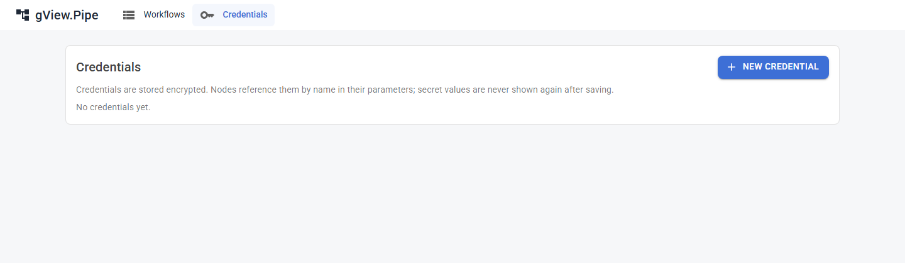

# Credentials

Ein **Credential** enthält die Zugangsdaten, die ein Node braucht: ein Passwort, ein Token, einen SMTP-Server, einen Connection String. Du legst es einmal an und wählst es in Nodes aus. Das Geheimnis taucht nie im Workflow selbst auf.

Öffne **Credentials** in der oberen Leiste, um sie zu sehen.

## Ein Credential anlegen

1. Klicke auf **New credential**.
2. Wähle den **Typ** und gib einen **Namen** ein.
3. Fülle die Felder aus. **Geheime** Felder (Passwörter, Tokens) werden verdeckt angezeigt.
4. Speichere.

Die Liste zeigt Name, Typ und **Id** jedes Credentials. Die Id speichert der Workflow, und die Id trägt ein Administrator in die Konfiguration ein (zum Beispiel für einen Git-Server).

!!! important
    Nach dem Speichern werden geheime Felder **nie wieder angezeigt**. Um ein Geheimnis zu ändern, gibst du es neu ein. Credentials werden auf dem Server verschlüsselt gespeichert.

## Typen

| Typ | Benutzt von | Felder |
|---|---|---|
| Basic Auth | HTTP Request, Webhook Trigger, Git-Server | Benutzername, Passwort |
| Bearer Token | HTTP Request, Webhook Trigger, Git-Server | Token |
| API Key Header | HTTP Request, Webhook Trigger | Header-Name, Wert |
| Connection String | SQL | Provider (`sqlserver`, `postgres` oder `sqlite`), Connection String |
| SMTP | Send Email | Host, Port, Sicherheit (auto, SSL on connect, StartTLS, none), Benutzername, Passwort, Absenderadresse |

Die genauen Felder stehen bei den [Credential-Typen](nodes/credential-types.md) der Node-Referenz.

## Ein Credential verwenden

Parameter, die ein Credential brauchen, zeigen eine Auswahl mit den Credentials der passenden Typen. Wähle eines aus. Die Hinweise des Nodes sagen dir, wenn es fehlt.

- **HTTP Request:** Das Credential authentifiziert den Aufruf (Basic, Bearer oder ein API-Key-Header).
- **Webhook Trigger:** Aufrufer müssen den passenden `Authorization`-Header (oder API-Key-Header) senden. Ohne Credential ist der Webhook öffentlich.
- **SQL:** der Connection String und der Provider.
- **Send Email:** der SMTP-Server und das Login.
- **Skript-Nodes:** Die Felder des Credentials gehen als Umgebungsvariablen `PIPE_CREDENTIAL_<FELD>` an das Skript. Die Werte werden in Ausgabe und Logs maskiert.

## Gut zu wissen

- Ein Credential gehört zur ganzen App, nicht zu einem Workflow. Wer Workflows bearbeiten kann, kann jedes Credential *benutzen*, aber seine Geheimnisse nicht lesen.
- Workflow-Dateien enthalten nur die Credential-Id. Du kannst sie weitergeben, ohne Geheimnisse weiterzugeben; die andere Installation muss ein Credential mit derselben Id anlegen oder ein anderes auswählen.
- Beim Umzug einer Installation kopierst du die Ordner `credentials` **und** `keys` zusammen (siehe [Administratorhandbuch](../admin-guide/operations.md#backup)).
