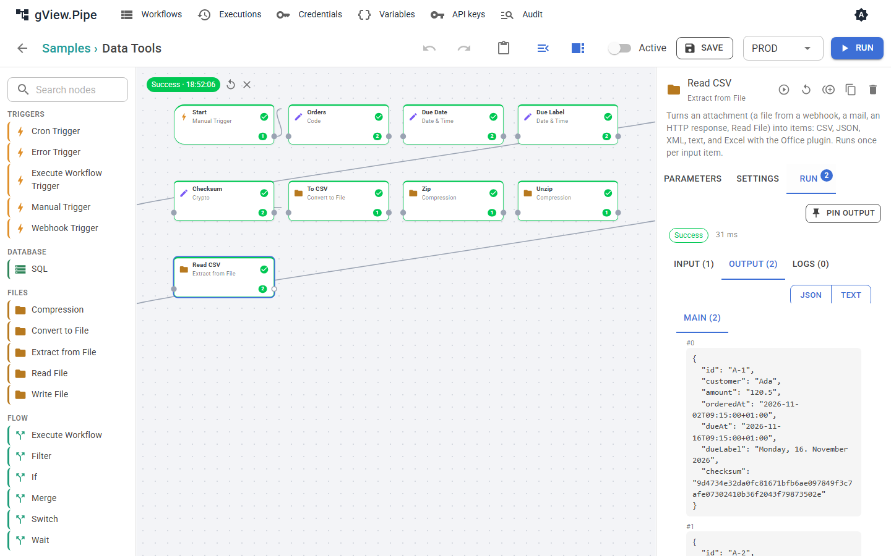

# Dateien und Daten

Dateien reisen durch einen Workflow als **Anhänge** von Items (siehe [Items und Ausdrücke](expressions.md)). Ein Webhook-Upload, ein Mail-Anhang, eine HTTP-Antwort oder Read File liefert einen; Send Email, Write File und HTTP Request nehmen einen entgegen. Die Nodes auf dieser Seite machen aus Anhängen Items und umgekehrt und arbeiten mit Datumswerten, Prüfsummen und Archiven. Das Beispiel **Data Tools** nutzt sie alle ([Rezepte](recipes.md#data-tools)).



## Extract from File

Liest den Anhang `data` (Einstellung *Binary property*) jedes Items in einem Format und macht daraus Items.

| Format | Ergibt | Einstellungen |
|---|---|---|
| CSV | ein Item pro Zeile; Werte sind Text | *Header row*, *Delimiter* (leer: aus der ersten Zeile erkannt), *Encoding* |
| Excel | ein Item pro Zeile; Zahlen bleiben Zahlen, Datumswerte werden ISO-Text | *Header row*, *Sheet* (leer: das erste). Braucht das Office-Plugin. |
| JSON | ein Objekt ist ein Item, ein Array ein Item pro Element | *Encoding* |
| XML | das ganze Dokument als ein Item, oder ein Item pro *Item element* | *Item element*, *Always array*, *Encoding* |
| Text | ein Item mit dem Inhalt in `text` | *Encoding* |

*Output* **Field** behält stattdessen das Eingangs-Item und legt alle Zeilen in ein Feld (`rows`). Das ist nützlich, wenn das Item mehr trägt als die Datei, etwa den Absender einer Mail.

Text wird als UTF-8 gelesen, außer die Datei beginnt mit einer Byte-Order-Mark oder *Encoding* sagt etwas anderes, zum Beispiel `windows-1252` für CSV-Dateien aus einem älteren Excel.

### XML als Items

XML-Elemente werden so zu JSON:

```xml
<order id="7" xmlns:x="urn:x"><line>Pen</line><line>Ink</line><x:note>fast</x:note></order>
```

```json
{ "@id": "7", "@xmlns:x": "urn:x", "line": ["Pen", "Ink"], "x:note": "fast" }
```

Attribute beginnen mit `@`, Text neben Attributen oder Elementen steht in `#text`, wiederholte Elemente werden Arrays. Ein Element, das nur einmal vorkommt, ist ein einzelner Wert: Trage es in *Always array* ein (z. B. `line`), wenn deine Ausdrücke ein Array erwarten.

## Convert to File

Schreibt Items in einen Anhang (`data`, Dateiname in *File name*, mit Ausdrücken).

- **CSV** und **Excel** machen immer eine Datei aus allen Items. Die Spalten sind alle Felder der Items in der Reihenfolge ihres Auftretens; verschachtelte Objekte werden als JSON geschrieben. Excel kann die Items auf ein Blatt pro Wert eines Feldes verteilen (*Sheet per field*, z. B. `region`).
- **JSON** schreibt ein Array aller Items, oder mit *Files* = *Each item* jedes Item als Objekt.
- **XML** schreibt alle Items als *Item element* unter *Root element* (`<items><item>…</item></items>`), oder ein Dokument pro Item. Ein von Extract from File gelesenes Item (`{ "order": { … } }`) wird mit derselben Wurzel zurückgeschrieben.
- **Text** schreibt das Feld *Text field* (`text`) der Items, eines pro Zeile.

## Date & Time

Arbeitet mit einem Datum und schreibt das Ergebnis in *Target field*.

| Operation | Ergebnis |
|---|---|
| Now | die aktuelle Zeit, in *Time zone*, falls gesetzt |
| Format | das Datum als Text im *Pattern* (z. B. `dd.MM.yyyy HH:mm`), in *Culture* (z. B. `de-DE` für deutsche Monatsnamen) und *Time zone* |
| Parse | Text im *Pattern* als ISO-Datum; Text ohne Offset liegt in *Time zone* |
| Add, Subtract | *Amount* in *Unit*; Monate und Jahre nur ganzzahlig |
| Difference | von *Date* bis *Until* (leer: jetzt) in *Unit*; Monate und Jahre zählen als ganze Kalendereinheiten |
| Convert time zone | derselbe Zeitpunkt in *Time zone* |
| Start of | Beginn von Tag, Woche (Montag), Monat, … in *Time zone* |

Datumswerte werden als ISO 8601 (`2026-11-02T08:30:00+01:00`), in gängigen Textformen oder als Unix-Sekunden bzw. -Millisekunden gelesen. Ergebnisse sind ISO 8601 mit Offset, der nächste Node liest sie also ohne Pattern. Zeitzonen sind IANA-Ids wie `Europe/Vienna` oder Windows-Ids. Die Muster folgen .NET: `yyyy` Jahr, `MM` Monat, `dd` Tag, `HH` Stunde, `mm` Minute, `dddd` Wochentag, `MMMM` Monatsname.

## Crypto

| Operation | Ergebnis |
|---|---|
| Hash | SHA-256, SHA-512, SHA-1 oder MD5 von *Value* oder eines Anhangs, als Hex oder Base64 |
| HMAC | eine Signatur von *Value* oder eines Anhangs mit *Secret*, z. B. um die Signatur eines Webhooks zu prüfen |
| UUID | eine neue zufällige Id |
| Base64 encode / decode | *Value* oder ein Anhang als Base64, oder Base64 zurück zu Text |

Nimm das HMAC-Geheimnis aus einer geheimen Variable (`{{ $vars.WEBHOOK_SECRET }}`, siehe [Variablen und Environments](variables.md)), damit es nicht im Workflow gespeichert wird. MD5 und SHA-1 taugen für Prüfsummen, nicht für Sicherheit.

## Compression

| Operation | Ergebnis |
|---|---|
| Zip | die Anhänge jedes Items, oder aller Items (*Zip* = *All items*), in einem ZIP-Archiv (*Archive name*) |
| Unzip | ein Item pro Datei des Archivs, mit der Datei in `data` und `fileName`, `path`, `size`; oder alle Dateien als Anhänge des Eingangs-Items |
| GZip / GUnzip | komprimiert oder entpackt einen Anhang |

Das Entpacken bricht mit einem Fehler ab, wenn der Inhalt größer als *Max size* (500 MB) wird, damit ein kleines Archiv den Server nicht füllen kann. Archive werden nie auf die Festplatte entpackt: Pfade im Archiv sind in den Items nur Text.

## SFTP

Der Node **SFTP** (Plugin `gView.Pipe.Plugins.Sftp`) listet, lädt herunter, lädt hoch, löscht und benennt Dateien auf einem SFTP-Server um. Er läuft einmal pro Eingabe-Item über eine Verbindung, und die Pfade erlauben Ausdrücke.

Lege zuerst ein [Credential](credentials.md) **SFTP Server** an: Host, Port, Benutzername, ein Passwort und/oder einen privaten Schlüssel und den **Fingerabdruck des Host-Keys** des Servers (`SHA256:…`). Der Fingerabdruck ist Pflicht: Ein Server mit einem anderen wird abgelehnt, und die Fehlermeldung zeigt den, den er vorgelegt hat. So kannst du ihn mit dem Betreiber des Servers prüfen und eintragen. Passwort, Schlüssel und Passphrase können aus einer [Secret-Quelle](../admin-guide/secrets.md) kommen.

| Operation | Was sie tut |
|---|---|
| List | Ein Item pro Datei in *Path* (`fileName`, `path`, `size`, `modifiedAt`, `isDirectory`). *File pattern* filtert (`*.csv`), *Include subfolders* geht tiefer, *Include folders* nimmt auch Ordner auf. Mehr als 10000 Einträge sind ein Fehler. |
| Download | Holt die Datei in *Path* (genau eine, kein Muster) und hängt sie ans Item, standardmäßig als `data`. Dateien über *Max file size (MB)* (100) werden abgelehnt, bevor sie geladen werden. |
| Upload | Schreibt den Anhang des Items nach *Path*. Eine vorhandene Datei ist ein Fehler, außer *Overwrite* ist an; ein fehlender Ordner ist ein Fehler, außer *Create folders* ist an. |
| Delete | Löscht die Datei in *Path*. |
| Rename | Benennt *Path* in *New path* um oder verschiebt ihn. Ein vorhandenes Ziel ist ein Fehler, außer *Overwrite* ist an. |

Ein Upload geht zuerst nach `<Name>.part` und wird umbenannt, wenn er vollständig ist, sodass ein Leser auf dem Server nie eine halbe Datei sieht. Mit *Overwrite* wird die alte Datei kurz vor diesem Umbenennen gelöscht.

Lokale Dateien rührt dieser Node nicht an: Inhalte reisen als Anhänge. Kombiniere ihn mit Read File und Write File, um eine Datei vom Server in einen freigegebenen Ordner zu holen oder von dort zu senden. Ein typischer Ablauf: **List** → **Download** (mit `{{ $json.path }}` als *Path*) → verarbeiten → **Rename** in einen Archivordner auf dem Server.
