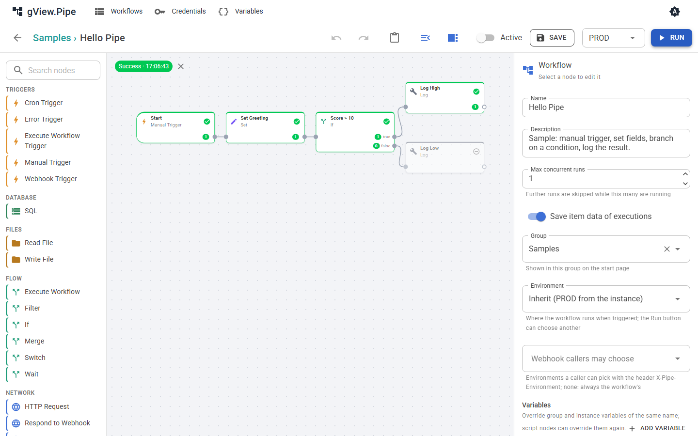
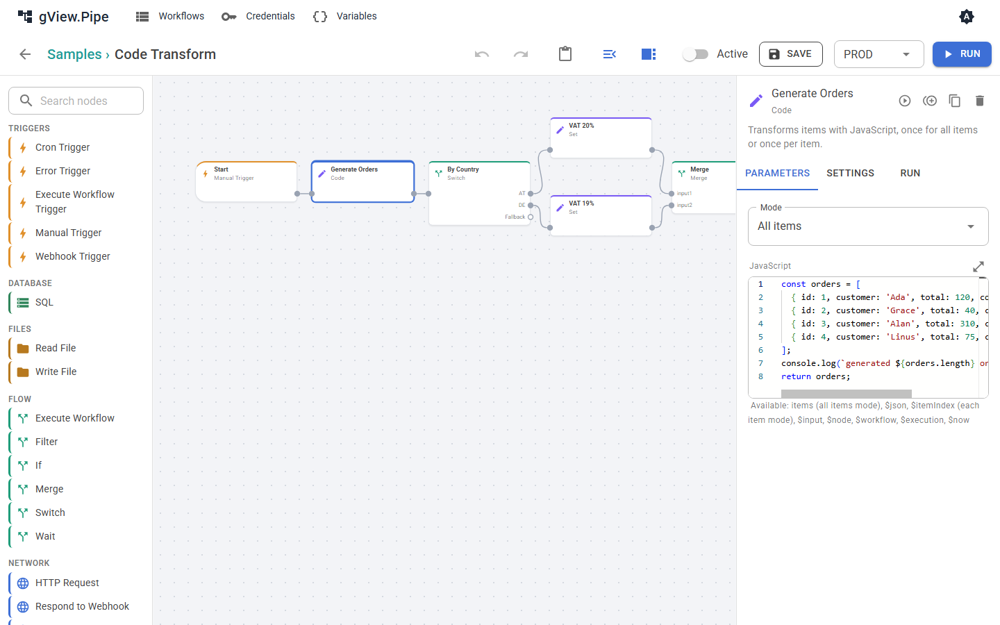
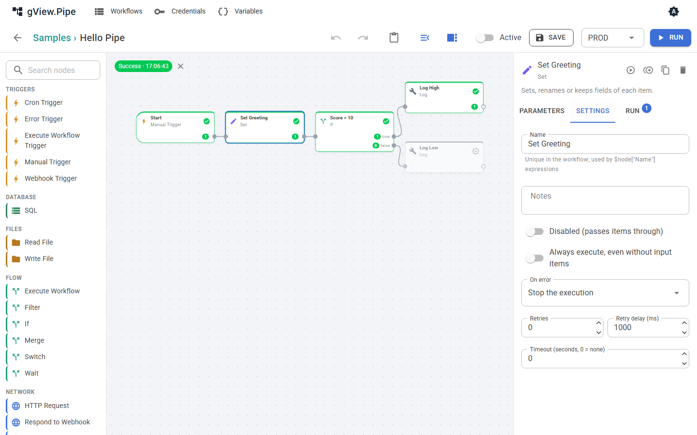
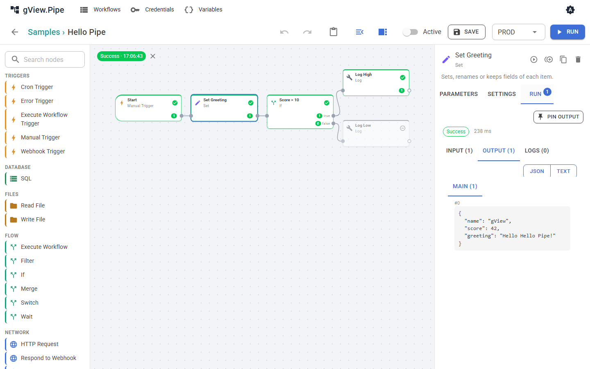
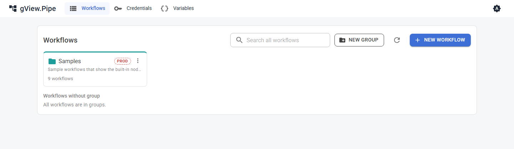

# Der Editor

Im Editor baust du einen Workflow: Nodes auf einer Arbeitsfläche, verbunden durch Linien. Öffne ihn aus der Workflow-Liste oder lege dort einen neuen Workflow an.

## Aufbau

| Bereich | Zweck |
|---|---|
| **Palette** (links) | Alle Node-Typen nach Kategorien, mit Suchfeld. Fahre über einen Node, um seine Beschreibung zu sehen. |
| **Arbeitsfläche** (Mitte) | Der Workflow. Nodes zeigen Name und Typ; Ports sind die Punkte an ihren Rändern. |
| **Seitenpanel** (rechts) | Ohne gewählten Node: die Einstellungen des Workflows. Mit gewähltem Node: seine Parameter, Einstellungen und das Laufergebnis. |
| **Werkzeugleiste** (oben) | Zurück, Rückgängig und Wiederholen, Einfügen, Palette und Seitenpanel ein- und ausblenden, der Schalter **Active**, **Save** und **Run**. |

Palette und Seitenpanel änderst du in der Breite, indem du den schmalen Balken neben ihnen ziehst. Ein Doppelklick setzt die Breite zurück. Zwei Schaltflächen der Werkzeugleiste blenden sie aus und wieder ein, damit die Arbeitsfläche mehr Platz hat; der Browser merkt sich das. Ein großer Workflow wird mit mindestens 70 % angezeigt, damit die Namen lesbar bleiben; den Rest erreichst du durch Verschieben der Arbeitsfläche.

Das Symbol rechts in der oberen Leiste wechselt die Farben: wie das System, hell oder dunkel. Der Browser merkt sich deine Wahl.

## Einen Workflow bauen

1. **Node hinzufügen:** Klicke ihn in der Palette an. Er erscheint auf der Arbeitsfläche; ziehe ihn an die gewünschte Stelle.
2. **Nodes verbinden:** Ziehe von einem Ausgangsport (rechter Rand) zu einem Eingangsport (linker Rand) eines anderen Nodes. Items fließen entlang der Linie. Ein Node mit mehreren Ausgängen (If, Switch) hat je Ausgang einen Port.
3. **Node bearbeiten:** Klicke ihn an. Das Seitenpanel zeigt die Tabs **Parameters**, **Settings** und **Run**.
4. **Löschen:** Wähle einen Node oder eine Linie und drücke **Entf**, oder nimm das Papierkorb-Symbol im Seitenpanel.
5. **Speichern:** **Save** oder **Strg+S** speichert den Workflow. Verlässt du den Editor oder schließt den Tab mit ungespeicherten Änderungen, fragt er vorher nach. Trigger eines aktiven Workflows (Cron, Webhook) werden beim Speichern scharf geschaltet.

!!! tip
    Halte **Umschalt** (Shift) gedrückt, während du einen Node auf eine bestehende Linie ziehst, um ihn dort einzufügen. Die Linie leuchtet auf, bevor du loslässt.

Der erste Node eines Workflows ist ein **Trigger** (siehe [Trigger und Webhooks](triggers.md)). Ein Workflow kann mehrere Trigger haben; ein manueller Lauf startet an jedem Node ohne eingehende Verbindung.

### Kopieren, Einfügen und Rückgängig

- **Kopiere** eine Auswahl mit Strg+C auf der Arbeitsfläche, **füge** sie mit Strg+V **ein**. Das funktioniert auch in einem anderen Workflow, du kannst also Teile zwischen Workflows verschieben. Die Werkzeugleiste hat dafür auch eine Einfügen-Schaltfläche.
- **Dupliziere** einen Node mit dem Symbol im Seitenpanel.
- **Rückgängig** und **Wiederholen** (Strg+Z, Strg+Y oder Strg+Umschalt+Z auf der Arbeitsfläche, oder die Werkzeugleiste) gelten für jede Änderung am Workflow. Tippen in die Felder eines Nodes zählt als ein Schritt.

## Die Tabs eines Nodes

### Parameters

Das Formular wird aus dem Node erzeugt. Die meisten Textfelder akzeptieren **Ausdrücke**: `{{ $json.total * 1.2 }}` wird für jedes Item ausgewertet (siehe [Items und Ausdrücke](expressions.md)). Im Tab **Run** kannst du ein Feld der Eingabe anklicken, um es als Ausdruck in den zuletzt bearbeiteten Parameter einzufügen.

Änderungen gelten schon während du tippst; du musst ein Feld nicht verlassen, bevor du einen anderen Node wählst oder speicherst.

Ausdrücke sind in ihrem Feld farbig hinterlegt. Nach einem Lauf zeigt eine Zeile unter dem Feld ihren Wert für das erste Eingangs-Item des Nodes, zum Beispiel `= Hello Hello Pipe!`. `$node["Name"]` lässt sich dort nicht auflösen und zeigt eine Warnung; der Lauf selbst ist davon nicht betroffen.

**Code-Felder** (das JavaScript des Code-Nodes, das SQL des SQL-Nodes, rohes JSON) öffnen sich in einem Code-Editor mit Syntaxhervorhebung, Zeilennummern und den üblichen Editor-Tasten (Tab zum Einrücken, Strg+F zum Suchen, Alt+Hoch/Runter zum Verschieben von Zeilen). Das Feld wächst mit seinem Inhalt; das Symbol darüber öffnet einen großen Editor, und **Apply** übernimmt dessen Text.

Manche Nodes zeigen über ihren Parametern **Hinweise**, zum Beispiel die URL eines Webhooks oder die Warnung, dass er kein Credential hat.

### Settings

| Einstellung | Bedeutung |
|---|---|
| Name | Eindeutig im Workflow. Ausdrücke nutzen ihn: `$node["Name"]`. |
| Notes | Freitext für dich. |
| Disabled | Der Node reicht seine Items durch, ohne zu laufen. |
| Always execute | Den Node auch laufen lassen, wenn er keine Items bekommen hat. |
| On error, Retries, Timeout | Siehe [Fehlerbehandlung](error-handling.md). |

### Run

Nach einem Lauf zeigt dieser Tab die **Input**-Items, die der Node bekommen hat, die **Output**-Items je Port und seine **Logs**. Items lassen sich als JSON oder als Text anzeigen. Schreibt ein Node während des Laufs Ausgaben (zum Beispiel ein Skript), siehst du sie live.

## Ausführen und Testen

- **Run** startet den Workflow aus dem Editor, im Environment, das neben dem Knopf gewählt ist (siehe [Variablen und Environments](variables.md#in-einem-anderen-environment-laufen)). Die Nodes zeigen ihren Zustand: grün bei Erfolg, rot bei einem Fehler, grau, wenn sie keine Items bekamen und übersprungen wurden. Ein Zähler an jedem Ausgang zeigt, wie viele Items er erzeugt hat.
- **Run to here** (Play-Symbol im Seitenpanel) führt nur den gewählten Node und die Nodes aus, von denen er abhängt.
- **Pin output** (im Tab **Run**) behält die Ausgabe eines Nodes. Manuelle Läufe nehmen dann die festgehaltenen Items, statt den Node erneut auszuführen. Das ist nützlich bei Nodes, die eine langsame oder kostenpflichtige API aufrufen. Festgehaltene Nodes zeigen ein Pin-Symbol. Läufe, die ein Trigger startet, ignorieren festgehaltene Daten, Produktivläufe arbeiten also nie mit Testdaten.
- Ein Klick auf das **x** am grünen oder roten Ergebnis über der Arbeitsfläche löscht die Anzeige des letzten Laufs.

## Gruppen

Workflows werden in **Gruppen** einsortiert, die als Kacheln auf der Startseite erscheinen. Ein Workflow gehört zu höchstens einer Gruppe. Ändere sie mit dem Feld **Group** im Workflow-Panel, mit **Move to group** in der Liste oder indem du eine Zeile auf eine Kachel ziehst.

Öffne eine Gruppe, um ihre Workflows zu sehen und dort neue anzulegen. Das Löschen einer Gruppe löscht nie ihre Workflows.

## Einstellungen des Workflows

Wähle keinen Node (klicke auf die leere Arbeitsfläche), um die Einstellungen des Workflows zu sehen:

| Einstellung | Bedeutung |
|---|---|
| Name, Description | Erscheinen in der Liste. |
| Max concurrent runs | Wie viele Läufe dieses Workflows gleichzeitig aktiv sein dürfen (Vorgabe 1). Weitere werden übersprungen; ein Webhook-Aufrufer bekommt `429`. |
| Save item data of executions | Schalte es aus, um nur Status, Zähler und Logs in der Historie zu speichern (sensible Daten). |
| Group | Die Gruppe auf der Startseite. |
| Environment | Das Environment für Läufe durch Trigger, oder *Inherit* von der Gruppe oder der Instanz. Siehe [Variablen und Environments](variables.md). |
| Webhook callers may choose | Environments, die ein Webhook-Aufrufer mit `X-Pipe-Environment` wählen kann. |
| Variables | Variablen dieses Workflows, ein Wert je Environment. |
| Error workflow | Wird gestartet, wenn ein durch Trigger gestarteter Lauf fehlschlägt, siehe [Fehlerbehandlung](error-handling.md#fehler-workflows). |
| Executions | Die Historie dieses Workflows, siehe [Executions](executions.md). |
