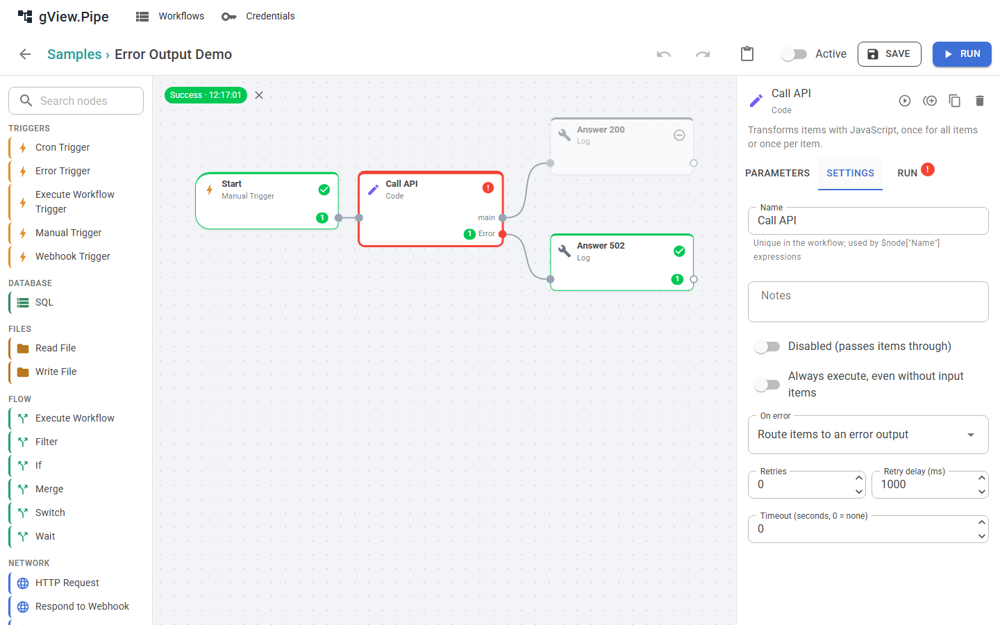

# Fehlerbehandlung

Ein Node kann fehlschlagen: Ein Skript endet mit einem Exit-Code ungleich 0, ein HTTP-Aufruf liefert einen Fehler, eine Datenbank ist nicht erreichbar. Was dann passiert, bestimmst du pro Node und pro Workflow mit einem optionalen Fehler-Workflow.

## Node-Einstellungen

Öffne einen Node und wechsle auf den Tab **Settings**.


| Einstellung | Bedeutung |
|---|---|
| Retries, Retry delay (ms) | Der Node wird nach einem Fehler bis zu so oft wiederholt. |
| Timeout (seconds) | Der Node wird nach dieser Zeit abgebrochen. 0 bedeutet kein Timeout. |
| **On error** | Was der Workflow tut, wenn der Node trotzdem fehlschlägt (siehe unten). |

### On error

| Modus | Was passiert | Status des Laufs |
|---|---|---|
| **Stop the execution** (Standard) | Der Lauf wird abgebrochen. Nodes nach dem fehlgeschlagenen laufen nie. | **Error** |
| **Continue with the input items** | Der Fehler wird am Node vermerkt, und der Node gibt seine Eingangs-Items am normalen Ausgang weiter (ein Skript-Node gibt seine Ergebnisse weiter, zum Beispiel den Exit-Code). Der Workflow läuft weiter. | Success |
| **Route items to an error output** | Der Node bekommt einen zweiten Ausgang, `error`. Die Items gehen dorthin statt zum normalen Ausgang, jeweils mit einem Feld `error` `{ "message": …, "type": … }`. Der normale Ausgang bleibt leer. | Success |



Ein Node, dessen Eingänge alle leer sind, wird übersprungen, ebenso die Nodes danach. Genau das macht den Fehlerausgang nützlich: Verbinde einen Zweig mit dem normalen Ausgang und einen anderen mit dem Ausgang `error`. Es läuft nur der Zweig, der Items bekommt.

!!! note
    Bei *Continue* oder *Error output* gilt der Lauf als **erfolgreich**. Das hat zwei Folgen: Der [Fehler-Workflow](#fehler-workflows) wird *nicht* gestartet, und ein Webhook-Aufrufer bekommt kein `500`, außer du sendest es selbst.

## Fehler-Workflows

Ein Fehler-Workflow ist ein normaler Workflow, der mit einem **Error Trigger** beginnt. Du wählst ihn im Workflow-Panel des fehlschlagenden Workflows (**Error workflow**).

- Er läuft, wenn ein Lauf des Workflows fehlschlägt und von einem Trigger (Cron, Webhook) oder als Sub-Workflow gestartet wurde. Läufe, die du von Hand im Editor startest, starten ihn nicht.
- Er bekommt ein Item, das den fehlgeschlagenen Lauf beschreibt, zum Beispiel für eine Mail mit dem Namen des Workflows und des fehlgeschlagenen Nodes:

    ```json
    { "workflow": { "id": "…", "name": "…" },
      "execution": { "id": "…", "mode": "…", "startedAt": "…", "error": "…" },
      "node": { "id": "…", "name": "…" } }
    ```

    Du nutzt es in Ausdrücken, zum Beispiel `{{ $json.workflow.name }}` und `{{ $json.execution.error }}`.
- Ein Fehler des Fehler-Workflows selbst wird nur ins Anwendungslog geschrieben. Ein Workflow kann nicht sein eigener Fehler-Workflow sein.
- Er ändert das Ergebnis des fehlgeschlagenen Laufs **nicht**. Der Lauf bleibt **Error**.

Der Beispiel-Workflow **Error Alerts** ist ein Fehler-Workflow.

## Einen Webhook nach einem Fehler beantworten

Ein Webhook, der auf einen Respond-to-Webhook-Node wartet ([Trigger und Webhooks](triggers.md#respond-to-webhook)), bekommt `500`, wenn der Lauf fehlschlägt, weil der Respond-Node nie erreicht wird. Der Fehler-Workflow hilft hier nicht: Er läuft getrennt und kann den Aufruf nicht beantworten.

Um die Antwort selbst zu bestimmen, behandle den Fehler im Workflow:

1. Stelle **On error** des Nodes, der fehlschlagen kann, auf **Route items to an error output**.
2. Verbinde den normalen Ausgang mit einem **Respond to Webhook**-Node mit Status `200`.
3. Verbinde den Ausgang `error` mit einem zweiten **Respond to Webhook**-Node. Statuscode und Body wählst du selbst, zum Beispiel Status `502` mit *Custom body* `{{ { error: $json.error.message } }}`.
4. Optional: Setze auf den `error`-Zweig vor den Respond-Node einen **Send Email**-Node (oder einen **Log**-Node), um benachrichtigt zu werden.

Weil der Zweig ohne Items übersprungen wird, läuft genau einer der beiden Respond-Nodes.

!!! tip
    Mit **Continue with the input items** kannst du bei einem Respond-Node bleiben. Prüfe das Ergebnis im Node nach dem, der fehlschlagen kann (zum Beispiel mit einem **If**-Node, der den Exit-Code prüft), und wähle den Statuscode mit einem Ausdruck.

Wenn du eine saubere Antwort *und* den Fehler-Workflow willst, sende die Benachrichtigung aus dem `error`-Zweig, wie in Schritt 4. Der Fehler-Workflow startet nur für Läufe, die mit **Error** enden.

## Herausfinden, was fehlgeschlagen ist

- Im Editor ist ein fehlgeschlagener Node rot umrandet und trägt ein Fehler-Badge. Sein Tab **Run** zeigt Eingabe, Ausgabe und Log, einschließlich der Fehlermeldung.
- Webhook-Antworten mit `500` enthalten die `executionId`. Öffne diese Execution in der Historie.
- Skripte: Ein Exit-Code ungleich 0 oder eine Ausgabezeile, die zum Fehlermuster passt, lässt den Node fehlschlagen. Die Ausgabe des Skripts steht im Log des Nodes.
