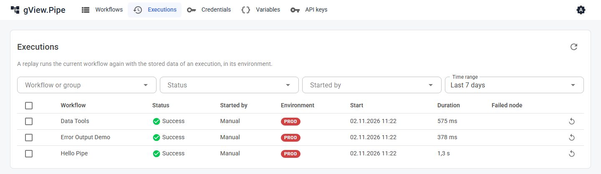

# Executions

Eine **Execution** ist ein Lauf eines Workflows, gestartet vom Editor, von einem Trigger oder von einem anderen Workflow. gView.Pipe zeichnet jede Execution auf, mit dem, was jeder Node bekommen, erzeugt und geloggt hat.

## Läuft gerade

Die Startseite listet jeden laufenden Lauf, egal wer ihn gestartet hat (der Editor, Cron, ein Webhook oder ein Sub-Workflow). Jeder Eintrag zeigt den Workflow, seinen aktuellen Node und die letzte Ausgabezeile. Die obere Leiste zeigt **n running**.

Klicke einen Lauf an, um ihn im Editor **live zu verfolgen**. Im Editor kannst du ihn auch **stoppen**. Läufe, die ein Webhook gestartet hat, laufen weiter, auch wenn der Aufrufer die Verbindung trennt; Stoppen ist also der Weg, einen früh zu beenden.

!!! note
    Die Liste zeigt Läufe dieser App-Instanz. Ein beendeter Lauf bleibt eine Minute sichtbar.

## Historie

Das Workflow-Panel des Editors (ohne gewählten Node) listet die **Executions** des Workflows, die neueste zuerst, mit Status, Startzeit, [Environment](variables.md), wie er gestartet wurde (Manual, Trigger für Cron und Webhook, Sub-Workflow, Fehler-Workflow, Replay, API mit dem Namen des [API-Schlüssels](../admin-guide/api.md)) und der Dauer. Das Feld über der Liste filtert nach Environment. Die letzten 50 bleiben erhalten, sofern das Workflow-Panel (**Executions kept**, **Days kept**) oder die [Konfiguration](../admin-guide/configuration.md) nichts anderes festlegt.

Klicke eine Execution an, um sie auf der Arbeitsfläche zu öffnen: Jeder Node zeigt Zustand und Zähler, und im Tab **Run** jedes Nodes siehst du Eingabe, Ausgabe und Logs dieses Laufs. Ein Hinweis erscheint, wenn der Workflow seit dem Lauf geändert wurde, weil manche Nodes dann nicht mehr existieren.

| Status | Bedeutung |
|---|---|
| Success | Der Lauf ist durchgelaufen. Einzelne Nodes können fehlgeschlagen sein, wenn sie *Continue* oder *Error output* nutzen. |
| Error | Ein Node ist mit *Stop the execution* fehlgeschlagen. Der fehlgeschlagene Node ist rot markiert. |
| Canceled | Jemand hat den Lauf gestoppt. |
| Running | Läuft noch. |

Klicke auf das **x** neben dem Ergebnis über der Arbeitsfläche, um die Anzeige zu löschen und zum einfachen Workflow zurückzukehren.

## Alle Executions

**Executions** in der Navigation listet die Executions aller Workflows, die neueste zuerst: Workflow, Status, wie er gestartet wurde, Environment, Start, Dauer und der fehlgeschlagene Node. Filtern kannst du nach Workflow oder Gruppe, Status, Startart und Zeitraum (zu Beginn die letzten 7 Tage); **Load more** lädt ältere nach. Ein Klick auf eine Zeile öffnet die Execution im Editor.

## Replay

Ein **Replay** führt eine gespeicherte Execution erneut aus, etwa nachdem du die Ursache eines Fehlers behoben hast:

- Es läuft der **gespeicherte, aktuelle** Workflow, nicht der Stand des ursprünglichen Laufs.
- Es nutzt die gespeicherten Daten des ursprünglichen Laufs und läuft in dessen **Environment**.
- Es verhält sich wie ein getriggerter Lauf: Pin Data wird ignoriert, und der [Fehler-Workflow](error-handling.md) startet, wenn es fehlschlägt.
- Es erscheint mit der Startart **Replay** und dem Replay-Symbol.

Wo du es startest:

| Wo | Was erneut läuft |
|---|---|
| Replay-Knopf einer Zeile oder mehrere gewählte Zeilen auf der Seite Executions | Der ganze Workflow, mit der Trigger-Ausgabe des ursprünglichen Laufs. Mehrere Replays laufen nacheinander, das älteste zuerst. |
| **Replay from failed node** auf der Seite Executions | Fehlgeschlagene Executions ab ihrem fehlgeschlagenen Node, die anderen von vorne. |
| Replay-Symbol neben dem Ergebnis im Editor | Der ganze Workflow; das rote Symbol daneben startet ab dem fehlgeschlagenen Node. |
| **Replay from here** in der Werkzeugleiste eines gewählten Nodes, während ein Lauf angezeigt wird | Dieser Node und alles danach. Alle anderen Nodes übernehmen ihre Ausgaben aus dem angezeigten Lauf. |

Ein Replay wartet, bis der Workflow einen freien Platz hat (**Max concurrent runs**), statt übersprungen zu werden. Speichere im Editor zuerst deine Änderungen: Das Replay führt den gespeicherten Workflow aus.

!!! warning
    Executions ohne gespeicherte Item-Daten (**Save item data of executions** ausgeschaltet) lassen sich nicht wiederholen. Dateien eines Laufs (Binärdaten) werden nach dessen Ende nicht aufbewahrt: Ein Node, der eine solche Datei im Replay liest, schlägt fehl.

## Sensible Daten

Die Items einer Execution werden in der Historie gespeichert und bleiben damit für alle lesbar, die den Editor nutzen können. Schalte **Save item data of executions** im Workflow-Panel aus, wenn Items sensible Daten enthalten: Dann werden nur Status, Zähler und Logs gespeichert. Geheimnisse aus Webhook-Headern (`Authorization`, `Cookie`) gelangen nie in die Items.

## Executions und Neustarts

Laufende Executions liegen im Speicher der App. Beim Neustart enden sie. Ein wartender Wait-Node verliert seinen Lauf. Beendete Executions liegen in Dateien und überstehen einen Neustart.
