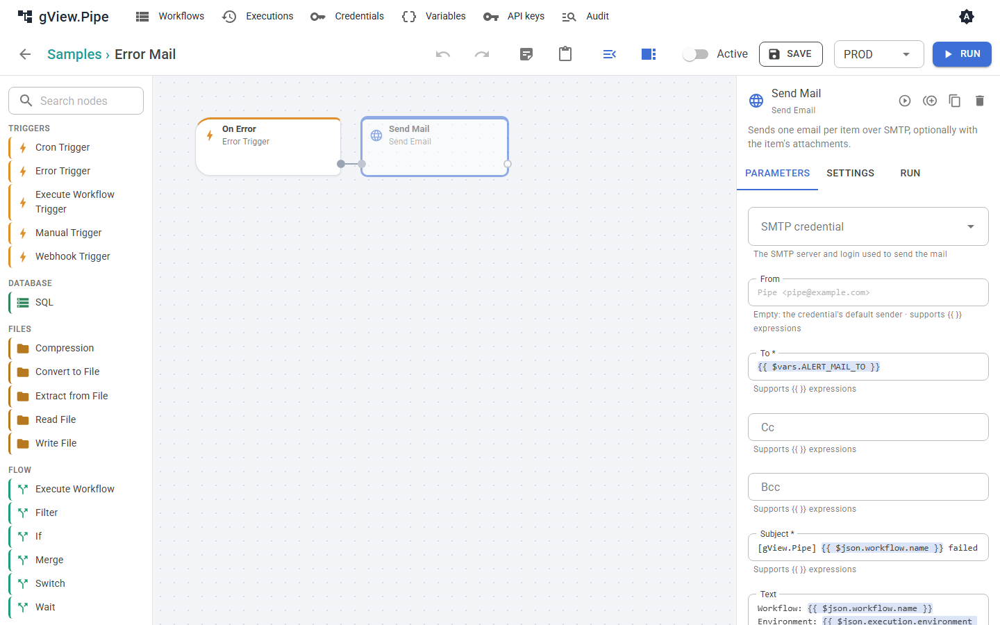

# Benachrichtigung bei Fehlern

Wenn ein zeitgesteuerter oder per Webhook gestarteter Workflow fehlschlägt, schaut niemand in den Editor. Ein [Fehler-Workflow](error-handling.md#fehler-workflows) kann stattdessen eine Nachricht schicken: eine Mail, einen Teams-Beitrag oder eine Slack-Nachricht. Die Gruppe Samples enthält für jeden Weg ein Beispiel.

| Beispiel | Schickt | Braucht |
|---|---|---|
| **Error Mail** | eine Mail mit Workflow, Environment, Node, Fehler und Link | ein SMTP-[Credential](credentials.md) und die Variable `ALERT_MAIL_TO` |
| **Error Teams** | eine Adaptive Card in einen Teams-Kanal | die geheime Variable `ALERT_TEAMS_URL` |
| **Error Slack** | eine Nachricht in einen Slack-Kanal | die geheime Variable `ALERT_SLACK_URL` |
| **Error Alerts** | eine Zeile im Anwendungslog | nichts |

## Einrichten

1. Öffne das Beispiel, etwa **Error Mail**. Sein sendender Node ist **deaktiviert**, damit eine frische Installation nichts verschickt.
2. Lege fest, was er braucht:
    - **Error Mail:** Wähle im Node *Send Mail* das SMTP-Credential und lege auf der Seite [Variablen](variables.md) die Variable `ALERT_MAIL_TO` an (eine oder mehrere Adressen, durch Kommas getrennt). Je Environment sind andere Werte möglich, zum Beispiel ein Team-Postfach für `PROD`.
    - **Error Teams:** Füge in Teams dem Kanal den Workflow *Post to a channel when a webhook request is received* hinzu und kopiere seine URL. Lege sie als geheime Variable `ALERT_TEAMS_URL` an.
    - **Error Slack:** Lege in deiner Slack-App einen Incoming Webhook an und speichere seine URL als geheime Variable `ALERT_SLACK_URL`.
3. Aktiviere den sendenden Node (auswählen, **Settings**, **Disabled** ausschalten) und speichere.
4. Wähle den Fehler-Workflow dort, wo er gelten soll:
    - für einen Workflow: **Error workflow** in seinem Workflow-Panel;
    - für eine Gruppe: **Error workflow** im Gruppen-Dialog (Stift auf der Gruppenkachel);
    - für alle Workflows: `Pipe:ErrorWorkflowId` in `pipe.config`, zum Beispiel `"error-mail"` ([Konfiguration](../admin-guide/configuration.md)).

    Ein Workflow nutzt den ersten, der auf Workflow → Gruppe → Instanz gesetzt ist. **None** an einem Workflow schaltet die Benachrichtigung für ihn ab, etwa für einen Test-Workflow.
5. Bitte den Administrator, `Pipe:PublicUrl` auf die Adresse zu setzen, unter der die App geöffnet wird. Dann enthalten die Nachrichten einen Link zum fehlgeschlagenen Lauf.

Kopiere ein Beispiel, statt es zu ändern, wenn du mehrere Varianten brauchst, etwa andere Empfänger je Gruppe.

## Wie oft Nachrichten kommen

**Throttle minutes** am Error Trigger (Vorgabe 15) begrenzt die Nachrichten je fehlgeschlagenem Workflow: Nach einer Nachricht werden weitere Fehler desselben Workflows für diese Zeit nur gezählt. Die nächste Nachricht sagt, wie viele es waren (`suppressed`). Ein Workflow, der jede Minute fehlschlägt, schickt deshalb eine Nachricht pro Viertelstunde, nicht 15. Mit 0 kommt jeder Fehler.

Weiteres, das die Zahl der Nachrichten klein hält:

- Läufe, die du im Editor startest, schicken nie Nachrichten.
- Ein fehlschlagender Sub-Workflow wird einmal gemeldet, vom Workflow, der ihn aufgerufen hat; die Nachricht nennt den Sub-Workflow und seinen fehlgeschlagenen Node.
- Ein Node mit *Continue* oder *Error output* lässt den Lauf nicht fehlschlagen und wird daher nicht gemeldet. Schicke bei Bedarf eine Nachricht aus seinem `error`-Zweig ([Fehlerbehandlung](error-handling.md)).

## Wieder normal

Ein Alarm sollte auch enden. Lege einen **Recovery Trigger** in denselben Workflow wie den Error Trigger und verbinde ihn mit einer Nachricht, wie der zweite Zweig der drei Beispiele (deaktiviert, bis du sie einrichtest). Er startet, wenn ein Workflow, der fehlgeschlagen war, wieder erfolgreich läuft.

- Er meldet eine Erholung nur, wenn vorher ein Fehler gemeldet wurde: Hat das Throttling alle Fehler verschluckt oder galt kein Fehler-Workflow, erfährt auch niemand von der Erholung.
- Nur Läufe durch Trigger, [Replay](executions.md#replay) oder die API zählen. Ein Lauf, den du im Editor startest, beginnt oder beendet keinen Fehlerzustand.
- Der Zustand liegt auf der Platte (`data/health`) und übersteht einen Neustart.
- Das Item ist `{ workflow, execution, failedSince, failedExecution, failures }`; `execution.url` und `failedExecution.url` verlinken die Läufe mit `Pipe:PublicUrl`.

| Ausdruck | Wert |
|---|---|
| `{{ $json.failedSince }}` | Beginn des ersten fehlgeschlagenen Laufs |
| `{{ $json.failures }}` | seither fehlgeschlagene Läufe, gemeldet oder nicht |

## Ausprobieren

Starte die Entwickler-Container mit Mailpit (`ADD_MAILPIT` im AppHost, siehe [Entwicklerhandbuch](../developer-guide/index.md)) und lege ein SMTP-Credential für `localhost`, Port `1025`, ohne TLS an. Richte damit **Error Mail** ein, lass einen Workflow mit Cron- oder Webhook-Trigger fehlschlagen (etwa einen Code-Node mit `throw new Error('test')`) und lass ihn über seinen Trigger laufen oder starte ein [Replay](executions.md#replay) eines fehlgeschlagenen Laufs. Die Mail erscheint unter http://localhost:8025.

## Eigene schreiben

Jeder Workflow, der mit einem **Error Trigger** beginnt, ist ein Fehler-Workflow. Sein Item ist unter [Fehlerbehandlung](error-handling.md#fehler-workflows) beschrieben. Nützliche Ausdrücke:

| Ausdruck | Wert |
|---|---|
| `{{ $json.workflow.name }}` | Name des fehlgeschlagenen Workflows |
| `{{ $json.execution.environment }}` | Environment des Laufs, zum Beispiel `PROD` |
| `{{ $json.node?.name ?? '-' }}` | der fehlgeschlagene Node, falls bekannt |
| `{{ $json.execution.error }}` | die Fehlermeldung |
| `{{ $json.execution.url ?? '' }}` | Link zum Lauf (mit `Pipe:PublicUrl`) |
| `{{ $json.suppressed }}` | seit der letzten Nachricht nicht gemeldete Fehler |
