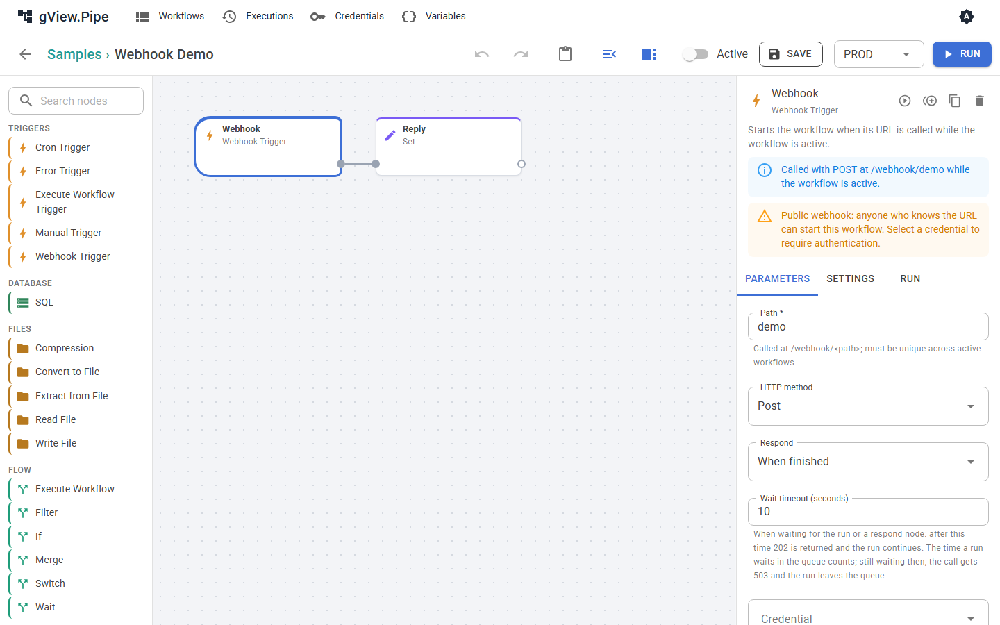

# Trigger und Webhooks

Ein Trigger ist der erste Node eines Workflows. Er bestimmt, wann der Workflow startet.

| Trigger | Startet den Workflow |
|---|---|
| Manual Trigger | Wenn du ihn im Editor ausführst. |
| Cron Trigger | Nach Zeitplan (Cron-Ausdruck mit 5 oder 6 Feldern), solange der Workflow aktiv ist. |
| Email Trigger | Wenn ungelesene Mails in einem Postfach (IMAP) liegen, solange der Workflow aktiv ist (siehe [unten](#email-trigger)). |
| File Trigger | Wenn neue Dateien in einem Ordner erscheinen, solange der Workflow aktiv ist (siehe [unten](#file-trigger)). |
| Webhook Trigger | Wenn seine URL aufgerufen wird, solange der Workflow aktiv ist. |
| Execute Workflow Trigger | Wenn ein anderer Workflow diesen mit dem Node Execute Workflow aufruft. |
| Error Trigger | Wenn ein Lauf eines anderen Workflows fehlschlägt (siehe [Fehlerbehandlung](error-handling.md)). |

## Webhook Trigger

Ein Webhook Trigger macht den Workflow unter dieser Adresse aufrufbar:

```
<Serveradresse>/webhook/<Pfad>
```

Der Editor zeigt die genaue URL als Hinweis neben den Parametern.



| Parameter | Bedeutung |
|---|---|
| Path | Buchstaben, Ziffern, `_`, `-` und `/`, klein geschrieben. Muss unter allen aktiven Workflows eindeutig sein. Für einen neuen Node wird ein zufälliger Pfad vorgeschlagen. |
| HTTP method | Standard `POST`, oder `GET`, `PUT`, `PATCH`, `DELETE`, oder jede Methode. |
| Respond | Wann und wie der Aufrufer eine Antwort bekommt (siehe unten). |
| Wait timeout (seconds) | Wie lange der Aufrufer in den wartenden Modi wartet. Danach bekommt er `202`, und der Lauf geht weiter. |
| Credential | Basic Auth, Bearer Token oder API Key Header. Ohne Credential kann **jeder, der die URL kennt, den Workflow starten**. |

!!! warning
    Ein Webhook ohne Credential ist öffentlich. Der Editor warnt dich davor.

### Der Aufruf als Item

Der Trigger macht aus dem Aufruf ein Item:

```json
{
  "method": "POST",
  "path": "orders/new",
  "query": { "id": "7" },
  "headers": { "content-type": "application/json" },
  "body": { "customer": "ACME" },
  "receivedAt": "2026-11-01T10:15:00.0000000+00:00"
}
```

- Ein JSON-Body (`Content-Type` enthält `json`) wird in `body` zu einem Objekt. Formularfelder werden zu einem Objekt. Jeder andere Body ist Text.
- Hochgeladene Dateien werden zu binären Anhängen des Items.
- Die Header `authorization`, `proxy-authorization`, `cookie` und der API-Key-Header werden entfernt, damit Geheimnisse nie in der Execution-Historie landen.
- Bodies über 10 MB werden mit `413` abgelehnt.

### Dem Aufrufer antworten

Der Parameter **Respond** bestimmt, was der Aufrufer bekommt.

| Modus | Der Aufrufer bekommt |
|---|---|
| **Immediately** | Sofort `202` mit `{ "executionId": …, "status": "started" }`. Der Workflow läuft im Hintergrund. Ob er gelingt, erfährt der Aufrufer nicht. |
| **When finished** | Die Items des Nodes, der zuletzt fertig wurde: ein Item als Objekt, mehrere als Array. Schlägt der Lauf fehl, bekommt der Aufrufer `500`. |
| **Using respond node** | Die Antwort eines **Respond to Webhook**-Nodes im Workflow. |

In beiden wartenden Modi bekommt der Aufrufer `202` mit `"status": "running"`, wenn der Lauf länger als das Timeout dauert. Der Lauf wird nie abgebrochen, wenn der Aufrufer die Verbindung trennt.

Ist der Workflow ausgelastet und hat eine Warteschlange (**Max queued runs** im Workflow-Panel), wartet der Lauf auf einen freien Platz. *Immediately* antwortet dann mit `"status": "queued"`. In den wartenden Modi zählt die Zeit in der Warteschlange zum Timeout: Wartet der Lauf bei dessen Ablauf noch, bekommt der Aufrufer `503` mit `Retry-After`, und der Lauf wird aus der Warteschlange genommen.

### Respond to Webhook

Der Node Respond to Webhook sendet die Antwort im Modus *Using respond node*. Du wählst Statuscode, Header und Body:

| Parameter | Bedeutung |
|---|---|
| Respond with | Das erste Item, alle Items als Array, ein eigener Body oder kein Body. |
| Body | Für *custom body*: JSON oder ein Ausdruck, ausgewertet gegen das erste Item. |
| Status code | 100 bis 599. Unterstützt Ausdrücke. |
| Headers | Optionale Antwort-Header. Ein Text-Body mit einem Nicht-JSON-`Content-Type` (zum Beispiel `text/html`) wird unverändert gesendet. |

Die Items laufen durch den Node, der Workflow kann also nach der Antwort weitermachen.

!!! important
    Die Antwort gibt es nur, wenn ein Respond-to-Webhook-Node **läuft**. Schlägt ein Node davor mit dem Fehlermodus *Stop the execution* fehl, endet der Lauf dort, der Respond-Node läuft nie, und der Aufrufer bekommt `500` mit der Fehlermeldung. Wie du auch im Fehlerfall antwortest, steht unter [Einen Webhook nach einem Fehler beantworten](error-handling.md#einen-webhook-nach-einem-fehler-beantworten).

### Statuscodes

| Code | Grund |
|---|---|
| 200 | Antwort des Workflows (*When finished*) oder eines Respond-to-Webhook-Nodes. |
| 202 | Gestartet oder eingereiht (*Immediately*), oder das Timeout ist abgelaufen, während der Lauf weitergeht. |
| 400 | Der Header `X-Pipe-Environment` nennt ein Environment, das der Workflow nicht erlaubt. |
| 401 | Das Credential fehlt oder ist falsch. |
| 404 | Unter diesem Pfad gibt es keinen aktiven Webhook. |
| 405 | Die Methode passt nicht zum Trigger. |
| 413 | Der Body ist zu groß. |
| 429 | Der Workflow läuft schon, sein Limit für gleichzeitige Läufe ist erreicht (Standard 1), und seine Warteschlange ist voll oder ausgeschaltet. |
| 503 | Der Lauf wartete beim Ablauf des Timeouts noch in der Warteschlange und wurde aus ihr genommen. Versuche es nach `Retry-After` Sekunden erneut. |
| 500 | Der Lauf ist fehlgeschlagen oder endete, ohne einen Respond-to-Webhook-Node zu erreichen. Der Body enthält den Fehler und die Execution-Id. |

Der `500`-Body sieht so aus: `{ "error": "…", "executionId": "…" }`. Suche die Execution-Id in der Execution-Historie, um zu sehen, welcher Node fehlgeschlagen ist.

### Das Environment wählen

Ein Webhook-Lauf nimmt das effektive Environment des Workflows (siehe [Variablen und Environments](variables.md)). Damit Aufrufer ein anderes wählen können, etwa um ein System gegen die Testdatenbank zu testen, trage es im Workflow-Panel unter **Webhook callers may choose** ein. Der Aufrufer schickt dann den Header:

```
X-Pipe-Environment: TEST
```

Ein Environment, das dort nicht steht, wird mit `400` abgelehnt und nie still ersetzt. Der Header wird nach dem Credential geprüft; ein Aufrufer ohne Zugang erfährt also nichts über die Environments.

### Ausprobieren

```bash
curl -i -X POST http://localhost:5240/webhook/demo -H "Content-Type: application/json" -d '{"name":"Ada"}'
```

In Windows PowerShell versteckt `Invoke-RestMethod` den Body einer Fehlerantwort. Nimm `curl.exe -i` (mit `-k` für das Entwicklungszertifikat auf `https://localhost:7240`), dann siehst du Statuscode und Body.

## File Trigger

Startet den Workflow, wenn neue Dateien in einem Ordner erscheinen. Der Ordner ist einer, den der Host mit `Pipe:FileRoots` freigegeben hat, derselbe wie bei Read File und Write File; du nennst ihn und, wenn du willst, einen Unterordner.

Der Trigger sieht alle *Check every* Sekunden (standardmäßig 10) in den Ordner. Eine Datei wird gemeldet, wenn Größe und Zeit in zwei Abfragen hintereinander gleich waren und kein anderes Programm mehr hineinschreibt; eine Datei, die gerade kopiert wird, wird also nicht halbfertig aufgenommen. Das dauert bis zu zwei Intervalle.

Jede Abfrage, die neue Dateien findet, startet **einen Lauf** mit **einem Item pro Datei** (höchstens 100 pro Lauf, der Rest folgt mit der nächsten Abfrage):

| Feld | Inhalt |
|---|---|
| `folder` | der Name des freigegebenen Ordners |
| `path` | der Pfad der Datei relativ zu diesem Ordner, mit `/` |
| `name` | der Dateiname |
| `size` | die Größe in Bytes |
| `modified` | der Zeitpunkt der letzten Änderung (ISO 8601, UTC) |
| `event` | `created` oder `changed` |

Die Items enthalten keinen Inhalt. Den liest Read File: nimm `{{ $json.path }}` als *Path* und denselben Ordner.

- **Welche Dateien:** *File pattern* (`*.csv`) und *Include subfolders*. *Events* ist *Created* (Standard) oder *Created or changed*.
- **Dateien, die schon da sind**, wenn der Workflow aktiviert wird oder die App startet, werden nicht gemeldet. Der Trigger merkt sich nichts auf der Platte; nach einem Neustart kennt er nur, was dann im Ordner liegt. Eine Datei, die verschwindet und wiederkommt, ist neu.
- **Verschiebe oder lösche die Datei** am Ende des Workflows (Write File), wenn sie nicht noch einmal auftauchen soll.
- Ist der Workflow beschäftigt und seine Warteschlange voll ([Fehlerbehandlung](error-handling.md)), warten die Dateien und werden mit der nächsten Abfrage wieder angeboten. Kann der Ordner nicht gelesen werden, wartet der Trigger darauf und schreibt eine Warnung ins Log.
- Eine Datei, die sich ständig ändert oder für ein anderes Programm offen bleibt, wird nicht gemeldet; das Log sagt es nach 30 Abfragen.

## Email Trigger

Startet den Workflow, wenn in einem Postfach (IMAP) ungelesene Mails liegen. Lege zuerst ein [Credential](credentials.md) **IMAP Server** an: Host, Port (993), Sicherheit (SSL on connect, StartTLS oder none für lokale Testserver), Benutzername und Passwort. Das Zertifikat des Servers wird immer geprüft. Anbieter, die nur eine OAuth2-Anmeldung zulassen, werden noch nicht unterstützt; nimm ein App-Passwort, wo der Anbieter eines anbietet. Das Passwort kann aus einer [Secret-Quelle](../admin-guide/secrets.md) kommen.

Der Trigger verbindet sich alle *Check every (seconds)* (standardmäßig 60, mindestens 10) und nimmt die **ungelesenen** Mails aus *Folder* (`INBOX`), die älteste zuerst. *From contains* und *Subject contains* grenzen auf dem Server ein; andere Mails werden nicht angefasst. Mails, die beim Aktivieren des Workflows schon ungelesen sind, zählen: Sie sind Arbeit, die noch nicht erledigt wurde.

Jede Abfrage, die Mails findet, startet **einen Lauf** mit **einem Item pro Mail** (höchstens 50, der Rest folgt mit der nächsten Abfrage):

| Feld | Inhalt |
|---|---|
| `messageId`, `uid`, `folder` | woher die Mail kommt |
| `from` | `name` und `address` des Absenders |
| `to`, `cc` | Listen aus `name` und `address` |
| `subject`, `date` | Betreff und Zeit (ISO 8601) |
| `text`, `html` | die beiden Inhalte, wenn die Mail sie hat |
| `attachments` | die Namen der Anhänge |
| `tooLarge` | `true`, wenn die Mail größer war als *Max message size (MB)* (25): dann sind nur die Kopffelder gefüllt |

Mit *Download attachments* (standardmäßig an) ist jeder Anhang ein Binär-Anhang des Items: `attachment1`, `attachment2`, … in der Reihenfolge von `attachments`. Eingebettete Bilder bleiben weg. Write File oder Send Email können sie verwenden.

**Nachdem der Lauf gestartet ist,** werden die Mails behandelt, wie *After processing* es sagt: *Mark as read* (Standard), *Move to folder* (der *Target folder* wird angelegt, wenn er fehlt) oder *Delete*. Behandelt wird, wenn der Lauf **startet**, nicht wenn er gelingt; ein fehlschlagender Lauf startet also nicht bei jeder Abfrage neu, und der [Fehler-Workflow](error-handling.md) meldet den Fehler. Ist der Workflow beschäftigt und seine Warteschlange voll, bleiben die Mails ungelesen und kommen mit der nächsten Abfrage. Lassen sie sich nicht markieren oder verschieben, steht das im Log, und dieser Trigger startet sie kein zweites Mal.

Der Trigger hält nichts auf der Platte: Das Postfach hält den Zustand, ein Neustart sieht also dieselben ungelesenen Mails. Nimm eine Instanz pro Postfach; zwei könnten dieselbe Mail abholen.
