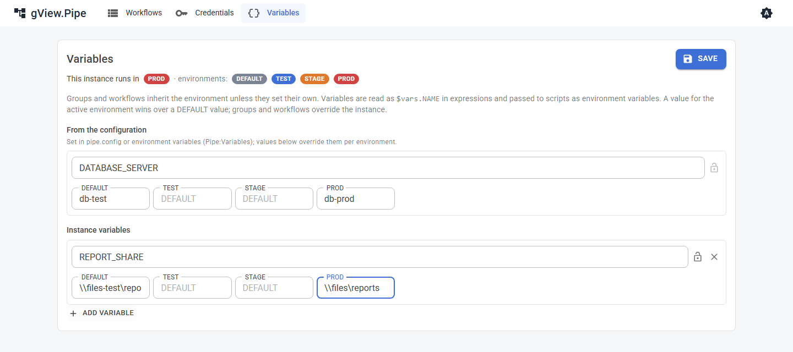
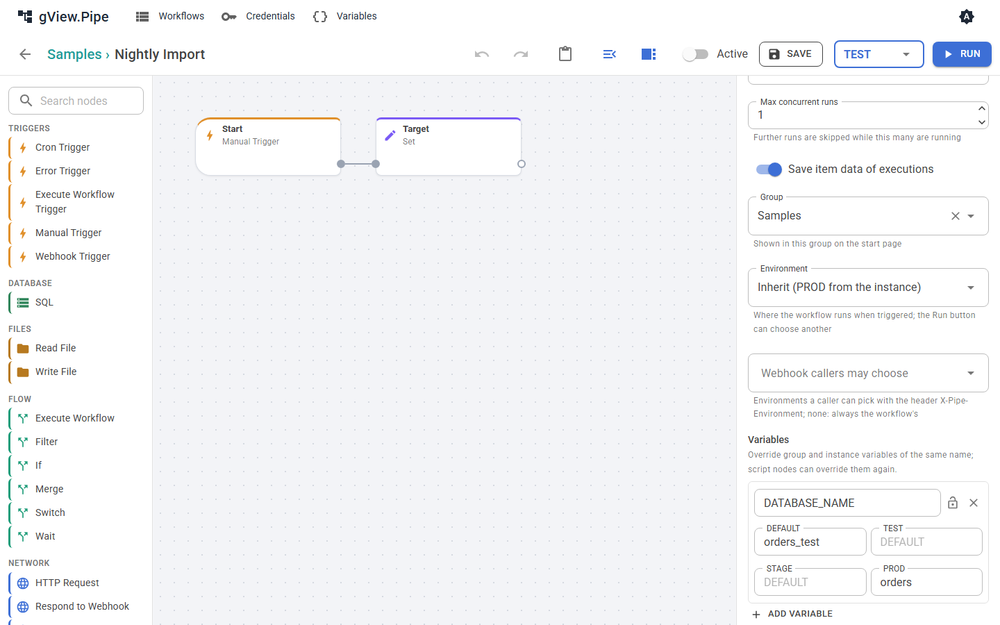

# Variablen und Environments

Viele Workflows brauchen dieselben Werte: einen Datenbankserver, eine Freigabe, die URL einer API. **Variablen** halten sie an einer Stelle, und **Environments** (zum Beispiel `TEST` und `PROD`) wählen, welcher Wert gilt. Ein Workflow kann so gegen die Testdatenbank laufen, ohne dass du einen Node änderst.

## Environments

Der Administrator legt die Environments in der [Konfiguration](../admin-guide/configuration.md#environments-und-variablen) fest. `DEFAULT` gibt es immer. Die Instanz läuft in genau einem davon; das stellt der Administrator ein, in der App lässt es sich nicht ändern.

Gruppen und Workflows setzen ein Environment oder **erben** es (Vorgabe):

1. das Environment des Workflows, wenn er eines setzt,
2. sonst das Environment seiner Gruppe, wenn sie eines setzt,
3. sonst das Environment der Instanz.

Das Ergebnis ist das **effektive Environment**. Die Workflow-Liste zeigt es als farbiges Badge (`PROD` rot, `STAGE` orange, `TEST` blau, `DEFAULT` grau). Ein nur umrandetes Badge ist geerbt; sein Tooltip nennt die Herkunft. Die Gruppen-Kacheln zeigen das Environment der Gruppe genauso.

Verschiebst du einen Workflow in eine andere Gruppe, kann sich ein geerbtes Environment ändern. Die App fragt dann nach, bevor sie ihn verschiebt („läuft in PROD statt TEST“).

## Variablen

Variablen gibt es auf drei Ebenen, jeweils mit einem Wert je Environment:

| Ebene | Wo |
|---|---|
| Instanz | **Variables** in der Menüleiste und die Konfiguration des Administrators. |
| Gruppe | **Edit** im Menü der Gruppen-Kachel. |
| Workflow | Das Workflow-Panel des Editors (kein Node gewählt). |

Namen bestehen aus Großbuchstaben, Ziffern und `_` (`DATABASE_SERVER`). Das Präfix `PIPE_` ist reserviert. Ein leerer Wert bedeutet „hier nicht gesetzt“.

### Welcher Wert gilt

Für das aktive Environment, etwa `PROD`:

1. ein `PROD`-Wert am Workflow, an der Gruppe oder an der Instanz, die unterste Ebene zuerst;
2. sonst ein `DEFAULT`-Wert am Workflow, an der Gruppe oder an der Instanz, die unterste Ebene zuerst.

Ein `PROD`-Wert der Instanz gewinnt also gegen einen `DEFAULT`-Wert des Workflows. Wer einen Wert je Environment überschreiben will, braucht einen Wert für genau dieses Environment.

Beispiel: Die Instanz hat `DATABASE_SERVER` = `db-test` für `DEFAULT` und `db-prod` für `PROD`. Workflows, die in `PROD` laufen, bekommen `db-prod`, alle anderen `db-test`.

### Variablen verwenden

- In Ausdrücken: `{{ $vars.DATABASE_SERVER }}`. `{{ $environment }}` ist das Environment des Laufs. Liest du eine Variable, die nicht definiert ist, stoppt der Node mit einem Fehler, der Variable und Environment nennt.
- In Skripten: Run Script, Run Scripts Folder und Run Scripts Repo bekommen alle Variablen als Umgebungsvariablen, dazu `PIPE_ENVIRONMENT`. Die **Environment variables** des Nodes überschreiben sie.

### Geheime Variablen

Das Schloss neben dem Namen macht eine Variable **geheim**. Ihre Werte werden verschlüsselt gespeichert, als Passwortfelder angezeigt und in Logs, Fehlermeldungen und Skriptausgaben durch `***` ersetzt. Passwörter und Schlüssel gehören trotzdem in [Credentials](credentials.md), wo ein Node eines unterstützt.

## In einem anderen Environment laufen

- **Run** im Editor: Das Feld neben dem Knopf wählt das Environment manueller Läufe. Es steht zuerst auf dem effektiven Environment, markiert mit *(saved)*. Eine andere Wahl wird in ihrer Farbe umrandet und gilt nur für Läufe aus dem Editor; sie wird nicht gespeichert.
- **Zeitpläne** (Cron Trigger) laufen immer im effektiven Environment.
- **Webhooks** laufen im effektiven Environment. Ein Aufrufer kann mit dem Header `X-Pipe-Environment: TEST` ein anderes wählen, aber nur eines, das im Workflow-Panel unter **Webhook callers may choose** steht. Jedes andere bekommt `400`, siehe [Trigger und Webhooks](triggers.md#das-environment-wahlen).
- **Sub-Workflows** und **Fehler-Workflows** laufen im Environment des Laufs, der sie gestartet hat. Ein Testlauf erreicht so nie über Execute Workflow die Produktionsdaten.

Jede Execution speichert ihr Environment. Die Execution-Liste des Workflows zeigt es und kann danach filtern.
