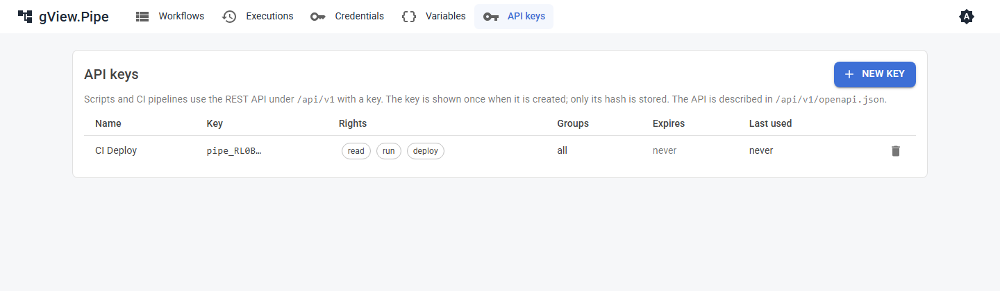

# REST API

Scripts and CI pipelines use the REST API under `/api/v1` to run workflows, look at executions and deploy workflows. The API has its own keys; it never uses the login of the UI.

## API keys

Create keys on the page **API keys** (navigation). A key has:

| Setting | Meaning |
|---|---|
| Name | Who or what uses it, e.g. `CI Deploy`. Runs started with the key show `API · CI Deploy` in the history. |
| Rights | **Read**: workflows, executions, groups. **Run**: start, stop, replay runs. **Deploy**: create, change, delete, activate workflows. |
| Only these groups | Limits the key to the workflows of these groups. It doesn't see other workflows at all, also not workflows without a group. |
| Expires | After this day the key is refused. Empty: never. |



The key (`pipe_…`) is shown **once**, when it is created. Only its SHA-256 is stored (`data/api-keys.json`), so a lost key can't be shown again: delete it and create a new one. The prefix `pipe_` lets secret scanners, e.g. of GitHub, recognize keys that were committed by mistake.

Send the key as a header:

```
X-Pipe-Api-Key: pipe_…
```

or as `Authorization: Bearer pipe_…`.

!!! warning
    Every signed-in user can create keys; there are no roles yet. With `Pipe:Auth:Mode` *none* that is everyone who can reach the UI. Protect the UI with a [login](authentication.md) before you rely on keys. More than 60 failed attempts per minute from one address answer `429`.

## Endpoints

The API is described in `/api/v1/openapi.json` (OpenAPI 3). Load it into a tool of your choice, e.g. Postman, Bruno or an OpenAPI viewer, to try the endpoints.

| Method and path | Right | Does |
|---|---|---|
| `GET /api/v1/workflows` | read | Lists the workflows. |
| `GET /api/v1/workflows/{id}` | read | The workflow as JSON, with its version as `ETag`. |
| `PUT /api/v1/workflows/{id}` | deploy | Creates or replaces the workflow (see below). |
| `DELETE /api/v1/workflows/{id}` | deploy | Deletes the workflow. |
| `POST /api/v1/workflows/{id}/activate`, `/deactivate` | deploy | Switches its triggers on or off. |
| `POST /api/v1/workflows/{id}/run` | run | Starts a run (see below). |
| `GET /api/v1/executions` | read | Executions, newest first. Filters: `workflowId`, `status`, `mode`, `from`, `before`, `limit`. |
| `GET /api/v1/executions/{workflowId}/{id}` | read | One execution with the input, output and logs of each node. |
| `POST /api/v1/executions/{workflowId}/{id}/cancel` | run | Stops a running or queued run. |
| `POST /api/v1/executions/{workflowId}/{id}/replay` | run | Runs the execution again; body `{ "fromNodeId": "…" }` to start at a node ([Replay](../user-guide/executions.md#replay)). |
| `GET /api/v1/groups` | read | Lists the workflow groups. |

Errors are answered as `application/problem+json` with a `title` that says what is wrong.

## Running a workflow

```
POST /api/v1/workflows/{id}/run
{ "items": [ { "name": "Ada" } ], "environment": "TEST", "wait": true, "timeoutSeconds": 30 }
```

All fields are optional. The run starts at every node without an incoming connection, with `items` as their input (default: one empty item). It behaves like a triggered run: pinned data is ignored, the [error workflow](../user-guide/error-handling.md#error-workflows) starts on failure and the queue of the workflow applies ([Max queued runs](../user-guide/editor.md#workflow-settings)).

| Answer | When |
|---|---|
| `200` `{ executionId, status, error, errorNode, node, items }` | `wait` and the run ended in time; `items` is the output of the node that finished last. A failed run is also `200`, with `status: "error"`. |
| `202` `{ executionId, status }` | Without `wait`, or the run takes longer than `timeoutSeconds`; ask `GET /executions/{workflowId}/{executionId}` later. |
| `429` | The workflow runs already and its queue is full. |

## Deploying a workflow

`PUT /api/v1/workflows/{id}` takes the JSON of a workflow, as `GET` returns it or as stored in `data/workflows`. Before saving it is checked: unique node ids and names, connections between existing nodes, no cycles, installed node types, valid parameters. Problems answer `422` with a list in `details.errors`. Credentials that don't exist on this server are `details.warnings` in the answer, not errors.

Send `If-Match` with the `ETag` of a `GET` to make sure nobody changed the workflow in between; otherwise you get `412`. Without `If-Match` the workflow is replaced. If the workflow is active, its triggers are armed again with the new version.

## Examples

=== "curl"

    ```bash
    KEY=pipe_...
    # run and wait for the result
    curl -s -X POST https://pipe.example.com/api/v1/workflows/hello-pipe/run \
      -H "X-Pipe-Api-Key: $KEY" -H "Content-Type: application/json" \
      -d '{ "items": [ { "name": "Ada" } ], "wait": true }'

    # deploy a workflow from a file
    curl -s -X PUT https://pipe.example.com/api/v1/workflows/hello-pipe \
      -H "X-Pipe-Api-Key: $KEY" -H "Content-Type: application/json" \
      --data-binary @hello-pipe.json

    # the last failed runs
    curl -s "https://pipe.example.com/api/v1/executions?status=error&limit=10" -H "X-Pipe-Api-Key: $KEY"
    ```

=== "PowerShell"

    ```powershell
    $headers = @{ "X-Pipe-Api-Key" = "pipe_..." }
    # run and wait for the result
    $body = @{ items = @(@{ name = "Ada" }); wait = $true } | ConvertTo-Json -Depth 5
    Invoke-RestMethod -Method Post -Uri https://pipe.example.com/api/v1/workflows/hello-pipe/run `
      -Headers $headers -ContentType "application/json" -Body $body

    # deploy a workflow from a file
    Invoke-RestMethod -Method Put -Uri https://pipe.example.com/api/v1/workflows/hello-pipe `
      -Headers $headers -ContentType "application/json" -InFile hello-pipe.json

    # the last failed runs
    Invoke-RestMethod -Uri "https://pipe.example.com/api/v1/executions?status=error&limit=10" -Headers $headers
    ```

Credentials, variables and groups can't be changed through the API; set them up in the UI.
