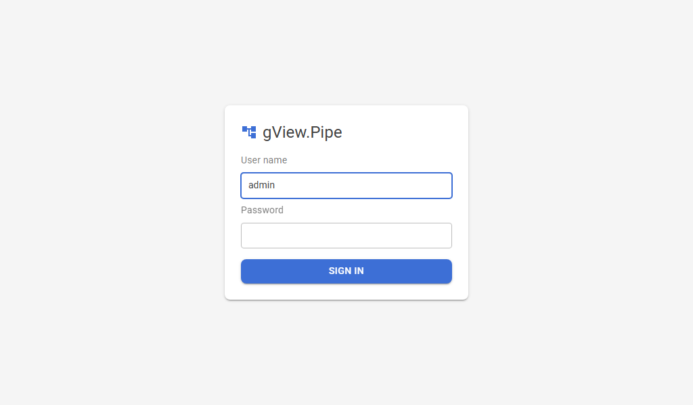

# Authentication

gView.Pipe has three login modes. You choose one per instance in `_config/auth.config`:

| Mode | Meaning |
|---|---|
| `none` | No login (default). Everyone who can reach the address may use the app. Use it only on `localhost` or a protected network. |
| `forms` | A login form with users from the configuration. |
| `oidc` | Login at an identity provider with OpenID Connect, for example IdentityServer.NET. |

The login protects the user interface. **Webhooks** and the **documentation** under `/docs` stay reachable without a login; protect webhooks with a credential (see [Security](security.md#webhooks)). Whoever is signed in may do everything.

## The file auth.config

On the first start the app creates `_config/auth.config` from the prototype `_setup/proto/auth.config`, next to `pipe.config` (see [Configuration](configuration.md)). Environment variables override it, for example `Pipe__Auth__Mode=forms`.

| Setting | Default | Meaning |
|---|---|---|
| `Pipe:Auth:Mode` | `none` | `none`, `forms` or `oidc`. |
| `Pipe:Auth:SessionMinutes` | `480` | Minutes without a request until the login expires. Every request extends it. |
| `Pipe:Auth:UseForwardedHeaders` | `false` | Trust the `X-Forwarded-For/-Proto/-Host` headers of a reverse proxy. Needed for OIDC behind a proxy that terminates https. |
| `Pipe:Auth:Users` | | Users of the `forms` mode, see below. |
| `Pipe:Auth:LoginAttemptsPerMinute` | `10` | Login attempts per minute and client address; more are answered with 429. |
| `Pipe:Auth:Oidc:*` | | Settings of the `oidc` mode, see below. |

## Forms: fixed users



```json
{
  "Pipe": {
    "Auth": {
      "Mode": "forms",
      "Users": [
        { "Name": "admin", "PasswordHash": "pbkdf2-sha256$210000$..." },
        { "Name": "editor", "Password": "plain text" }
      ]
    }
  }
}
```

- `PasswordHash` is preferred. Create it with the app itself:

    ```bash
    dotnet gView.Pipe.Shell.dll --hash-password "my password"
    ```

- `Password` in plain text works too, but logs a warning on every start. If both are set, the hash counts.
- User names are not case sensitive.
- After a wrong password the app waits a second; the number of attempts per address is limited.

### Docker: the admin password as a variable

```bash
docker run -d --name gview-pipe -p 8080:8080 \
  -v gview-pipe-data:/app/data \
  -e PIPE_ADMIN_PASSWORD=change-me \
  ghcr.io/jugstalt/gview-pipe:latest
```

`PIPE_ADMIN_PASSWORD` sets the password of the user `admin` (another name with `PIPE_ADMIN_USER`). It replaces that user from `auth.config`, keeps the other users and switches the mode `none` to `forms`.

## OIDC: identity provider

```json
{
  "Pipe": {
    "Auth": {
      "Mode": "oidc",
      "Oidc": {
        "Authority": "https://login.example.com",
        "ClientId": "gview-pipe",
        "ClientSecret": "secret",
        "Scopes": [ "openid", "profile", "role" ],
        "RoleClaimType": "role",
        "NameClaimType": "name",
        "RequiredRoles": [ "gview-pipe" ]
      }
    }
  }
}
```

| Setting | Default | Meaning |
|---|---|---|
| `Authority` | | Address of the identity provider. Required. |
| `ClientId` | | Client id at the provider. Required. |
| `ClientSecret` | | Secret of the client; leave it empty for a public client. In Docker: `Pipe__Auth__Oidc__ClientSecret`. |
| `Scopes` | `openid profile role` | Requested scopes. |
| `RoleClaimType` | `role` | Claim with the roles of the user. |
| `NameClaimType` | `name` | Claim shown as the user name. |
| `RequiredRoles` | (empty) | The user needs **one** of these roles. Empty: every user of the provider may enter. |
| `RequireHttpsMetadata` | `true` | Set it to `false` only for a test provider without https. |

The app uses the authorization code flow with PKCE. Register at the provider:

- the redirect URI `https://<app>/signin-oidc`,
- the post logout redirect URI `https://<app>/signout-callback-oidc`.

A user without one of the required roles sees a **No access** page with a **Sign out** button. Signing out also ends the session at the provider, so another account can sign in.

Behind a reverse proxy that terminates https, set `UseForwardedHeaders` to `true`, or the redirect URIs start with `http://` (see [Operations](operations.md#running-behind-a-reverse-proxy)).

### Testing with the IdentityServer.NET of the AppHost

The AppHost starts IdentityServer.NET at `https://localhost:8443` (`ADD_IDENTITYSERVER`, admin `admin@is.net` with the password `admin`) with the client `local-gview-pipe`/`secret` for `https://localhost:7240`. Windows must trust its self-signed certificate (import it into the user's trusted root certificates), or the browser and the app reject it. In its admin UI (`https://localhost:8443/admin`):

1. Create the role `gview-pipe` (**Roles**).
2. Create a user with this role and one without it (**Users**, then **User Roles**).
3. Set `Mode` to `oidc` in `_config/auth.config`; the prototype already contains the settings of this client.

The user with the role can work; the other one sees **No access**.

## Signing out

With a login, the account icon at the top right shows the user name and **Sign out**.
