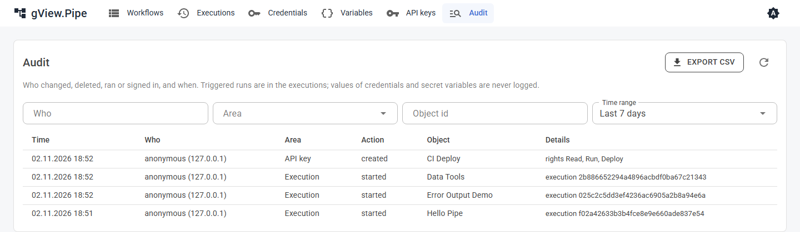

# Operations

## Running behind a reverse proxy

For access from other machines and for HTTPS, put a reverse proxy (IIS, nginx, Traefik, …) in front of the app. The app itself listens on plain HTTP.

- Forward `/` to the app. The editor uses a live connection (Blazor Server, WebSockets): enable WebSocket forwarding and don't cut idle connections too early.
- Webhooks are served under `/webhook/<path>`. If you want to expose only webhooks to the internet, forward just `/webhook/` and keep the editor internal.
- Without a login (`Pipe:Auth:Mode` = `none`), whoever can open the editor can create workflows and run everything you released. Switch on a login (see [Authentication](authentication.md)) or protect the editor with the proxy (authentication, IP restriction) or a VPN.
- With the login mode `oidc` behind a proxy that terminates HTTPS, set `Pipe:Auth:UseForwardedHeaders` to `true` and let the proxy send `X-Forwarded-Proto` and `X-Forwarded-Host`. Otherwise the app sends `http://` redirect URIs to the identity provider, which rejects them.

## Webhooks in production

- Webhooks only work while the workflow is **Active**. After a restart, all active workflows are armed again.
- A path belongs to exactly one workflow in the whole app. A second workflow with the same path can't be activated, and the editor shows the reason after saving.
- **Always set a credential** (Basic Auth, Bearer Token or API Key Header) on webhooks that are reachable from outside. Without one, anyone who knows the URL can start the workflow.
- The maximum body size is 10 MB (answer `413`). Callers that wait for the workflow have a timeout per webhook (default 30 seconds). After it they get `202` and the run continues.
- A workflow runs once at a time by default. More calls get `429` while it runs. Raise **Max concurrent runs** in the workflow panel if calls must run in parallel, or **Max queued runs** if they may wait. The queue is kept in memory: a restart drops waiting runs.
- Runs are not canceled when the caller disconnects.

How callers see failures is described in [Triggers and webhooks](../user-guide/triggers.md) and [Error handling](../user-guide/error-handling.md).

## Execution history

The latest 50 executions per workflow are kept in `data/executions/`; `Pipe:ExecutionRetention` and `Pipe:ExecutionRetentionDays` (see [Configuration](configuration.md)) and the workflow panel change that. Switch off **Save item data of executions** in the workflow panel, and only statuses, counts and logs are stored. That is useful when items contain sensitive data.

Executions that are running live in the memory of the process. A restart ends them, and a Wait node that is waiting loses its run.

## Audit log

The page **Audit** (admins only) shows who changed, deleted, ran or signed in, and when:

| Area | Recorded |
|---|---|
| Workflow | created, saved (with a summary: nodes added, removed and changed, connections, settings), deleted, activated, deactivated, moved, deployed through the API |
| Group | created, changed, deleted |
| Credential | created, changed, deleted; never the values |
| Variables | the instance variables changed; names only |
| API key | created, deleted |
| Login | signed in; failed sign-ins and refused API keys, at most one entry per minute and address, with the number of further attempts |
| Execution | started by hand or through the API, stopped, replayed |

Triggered runs are not in the audit log; the [execution history](../user-guide/executions.md) has them. *Who* is the user name, `api:<key name>` for the [REST API](api.md), or `anonymous` without a login.

Filter by person, area, object id and time, and export what is shown as CSV (*Export CSV*). The workflow panel of the editor shows the last changes of the workflow under **History**. Scripts read the log with `GET /api/v1/audit`.

The entries are kept as one file of JSON lines per month in `data/audit/` and deleted after `Pipe:AuditRetentionDays` (365, in whole months). Every entry is also written to the application log (category `gView.Pipe.Audit`). Who can write the data folder can change the files; if you need proof, keep the entries of a central log system.

## Backup

Back up the whole `data` folder, plus `files` and `scripts` if you use them:

| Folder | Content |
|---|---|
| `data/workflows/` | One JSON file per workflow. Suitable for Git. |
| `data/groups.json` | Groups of the start page. |
| `data/credentials/` | Credentials, encrypted. |
| `data/keys/` | The keys that decrypt the credentials. |
| `data/executions/` | History. Optional. |

!!! important
    Restore `credentials/` and `keys/` **together**. Without the keys, stored credentials can't be read, and you must enter them again.

Back up `_config` too (`pipe.config`, `auth.config`); it holds the settings and, in the login mode `forms`, the users. The keys in `data/keys/` also protect the login cookies: new keys sign everybody out.

For a consistent copy, stop the app or copy while nothing is running. Files are written through a temporary file and then moved into place.

## Updates

**ZIP:** unpack the new version next to the old one, stop the old app, start the new start script. `data`, `files` and `scripts` stay where they are. Keep the old version folder until the new one works; to go back, start its script again.

**Docker:** pull the new image and recreate the container with the same volumes.

Nodes store the version of their parameters and are migrated automatically when an older workflow runs. Make a backup of `data` before an update anyway.

## Logs

The app logs to the console (and to the Aspire dashboard if you run it with Aspire). Look at the log for plugin warnings at the start and for node failures. The log level is set in the `Logging` section of `appsettings.json`.
