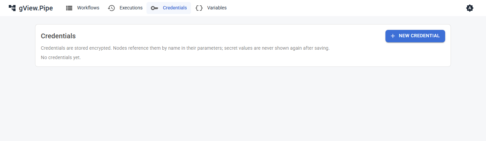

# Credentials

A **credential** holds the login data a node needs: a password, a token, an SMTP server, a connection string. You create it once and select it in nodes. The secret never appears in the workflow itself.

Open **Credentials** in the top bar to see them.

## Create a credential

1. Click **New credential**.
2. Choose the **type** and give it a **name**.
3. Fill in the fields. **Secret** fields (passwords, tokens) are masked.
4. Save.

The list shows the name, the type and the **id** of each credential. The id is what the workflow stores and what an administrator enters in the configuration (for example for a Git server).

!!! important
    After saving, secret fields are **never shown again**. To change a secret, enter it anew. Credentials are stored encrypted on the server.

## Types

| Type | Used by | Fields |
|---|---|---|
| Anthropic API | AI | API key |
| Azure OpenAI | AI | authentication (API key or managed identity), endpoint, deployment, API version, API key |
| Azure Storage | Azure Blob, Azure Blob Trigger | authentication (connection string, managed identity or SAS token), connection string, account URL, SAS token |
| Basic Auth | HTTP Request, Webhook Trigger, Git servers | user name, password |
| Bearer Token | HTTP Request, Webhook Trigger, Git servers | token |
| API Key Header | HTTP Request, Webhook Trigger | header name, value |
| OAuth2 Client Credentials | HTTP Request | token URL, client id, client secret, scope, audience, how the client credentials are sent (header or body) |
| Connection String | SQL | provider (`sqlserver`, `postgres` or `sqlite`), connection string |
| IMAP Server | Email Trigger | host, port, security (SSL on connect, StartTLS, none), user name, password |
| SFTP Server | SFTP | host, port, user name, password and/or private key (with passphrase), fingerprint of the host key |
| SMTP | Send Email | host, port, security (auto, SSL on connect, StartTLS, none), user name, password, sender address |

The exact fields are listed in the [credential types](nodes/credential-types.md) of the node reference.

## Use a credential

Parameters that need a credential show a drop-down with the credentials of the right types. Select one. The node's hints tell you when it is missing.

- **HTTP Request:** the credential authenticates the call (Basic, Bearer or an API key header).
- **Webhook Trigger:** callers must send the matching `Authorization` header (or API key header). Without a credential the webhook is public.
- **SQL:** the connection string and provider.
- **Send Email:** the SMTP server and login.
- **Script nodes:** the credential's fields are passed to the script as `PIPE_CREDENTIAL_<FIELD>` environment variables. Values are masked in the output and in the logs.

## OAuth2 client credentials

Many APIs hand out short-lived access tokens. With this credential HTTP Request fetches a token from the *Token URL* (grant `client_credentials`) and sends it as `Authorization: Bearer …`. The token is kept in memory and renewed a minute before it expires, so many requests and runs share one token; editing the credential gets a new one. If the API answers `401`, the token is dropped and the next attempt (a retry of the node, the next run) fetches a new one. Only this grant is supported, not the login of a user in the browser. For a token of a user, use a Bearer Token credential.

## Take a secret from another source

A secret field has a key button. It takes the value from an environment variable, Azure Key Vault or the vault of IdentityServer.NET instead of storing it in the credential. After saving, source and name show; *Check* tells whether the secret can be read. See [Secrets](../admin-guide/secrets.md).

## Good to know

- A credential belongs to the whole app, not to a workflow. Whoever can edit workflows can *use* every credential, but not read its secrets.
- Workflow files contain only the credential id. You can share them without sharing secrets; the other installation has to create a credential with the same id or select another one.
- If you move an installation, copy the `credentials` **and** the `keys` folder together (see the [Admin Guide](../admin-guide/operations.md#backup)).
