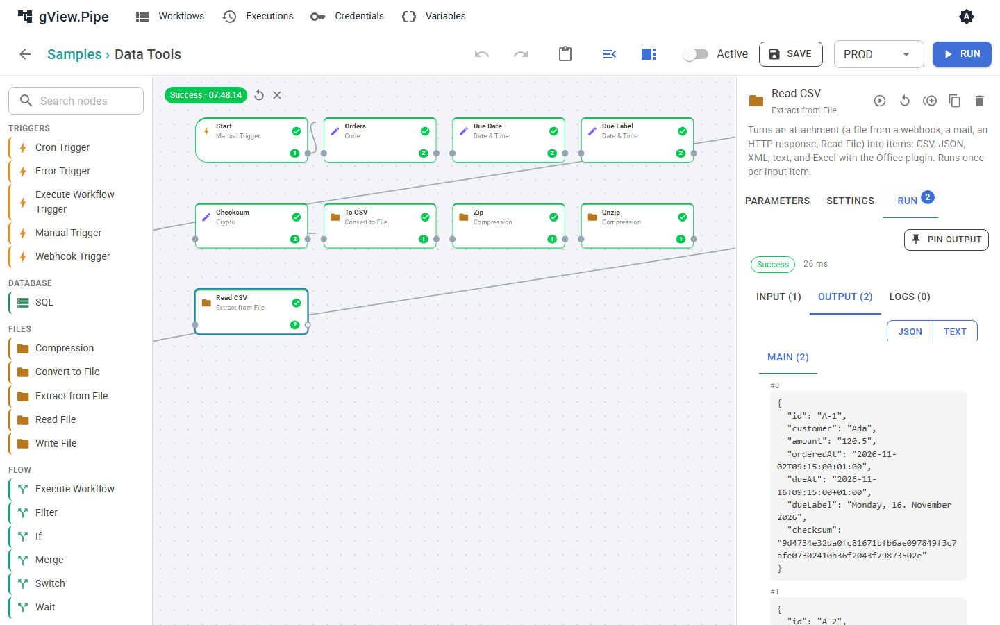

# Files and data

Files travel through a workflow as **attachments** of items (see [Items and expressions](expressions.md)). A webhook upload, a mail attachment, an HTTP response or Read File gives you one; Send Email, Write File and HTTP Request take one. The nodes on this page turn attachments into items and back, and work with dates, hashes and archives. The sample **Data Tools** uses all of them ([Recipes](recipes.md#data-tools)).



## Extract from File

Reads the attachment `data` (setting *Binary property*) of each item in a format and makes items of it.

| Format | Becomes | Settings |
|---|---|---|
| CSV | one item per row; values are text | *Header row*, *Delimiter* (empty: detected from the first row), *Encoding* |
| Excel | one item per row; numbers stay numbers, dates become ISO text | *Header row*, *Sheet* (empty: the first). Needs the Office plugin. |
| JSON | an object is one item, an array one item per element | *Encoding* |
| XML | the whole document as one item, or one item per *Item element* | *Item element*, *Always array*, *Encoding* |
| Text | one item with the content in `text` | *Encoding* |

*Output* **Field** keeps the input item and puts all rows into one field (`rows`) instead. Use it when the item carries more than the file, for example the sender of a mail.

Text is read as UTF-8 unless the file starts with a byte order mark or *Encoding* says otherwise, for example `windows-1252` for CSV files saved by an older Excel.

### XML as items

XML elements become JSON like this:

```xml
<order id="7" xmlns:x="urn:x"><line>Pen</line><line>Ink</line><x:note>fast</x:note></order>
```

```json
{ "@id": "7", "@xmlns:x": "urn:x", "line": ["Pen", "Ink"], "x:note": "fast" }
```

Attributes start with `@`, text next to attributes or elements is in `#text`, repeated elements become arrays. An element that occurs once is a single value: list it in *Always array* (e.g. `line`) when your expressions expect an array.

## Convert to File

Writes items into an attachment (`data`, file name in *File name*, with expressions).

- **CSV** and **Excel** always make one file of all items. The columns are all fields of the items in the order they appear; nested objects are written as JSON. Excel can put the items on one sheet per value of a field (*Sheet per field*, e.g. `region`).
- **JSON** writes an array of all items, or with *Files* = *Each item* each item as an object.
- **XML** writes all items as *Item element* below *Root element* (`<items><item>…</item></items>`), or one document per item. An item read by Extract from File (`{ "order": { … } }`) is written back with the same root.
- **Text** writes the field *Text field* (`text`) of the items, one per line.

## Date & Time

Works on a date and writes the result into *Target field*.

| Operation | Result |
|---|---|
| Now | the current time, in *Time zone* if set |
| Format | the date as text in *Pattern* (e.g. `dd.MM.yyyy HH:mm`), in *Culture* (e.g. `de-DE` for German month names) and *Time zone* |
| Parse | text in *Pattern* as ISO date; text without an offset is in *Time zone* |
| Add, Subtract | *Amount* of *Unit*; months and years only in whole numbers |
| Difference | from *Date* to *Until* (empty: now) in *Unit*; months and years are counted as whole calendar units |
| Convert time zone | the same moment in *Time zone* |
| Start of | the start of the day, week (Monday), month, … in *Time zone* |

Dates are read as ISO 8601 (`2026-11-02T08:30:00+01:00`), common text forms, or Unix seconds or milliseconds. Results are ISO 8601 with offset, so the next node reads them without a pattern. Time zones are IANA ids like `Europe/Vienna` or Windows ids. Patterns follow .NET: `yyyy` year, `MM` month, `dd` day, `HH` hour, `mm` minute, `dddd` weekday name, `MMMM` month name.

## Crypto

| Operation | Result |
|---|---|
| Hash | SHA-256, SHA-512, SHA-1 or MD5 of *Value* or of an attachment, as hex or Base64 |
| HMAC | a signature of *Value* or an attachment with *Secret*, e.g. to check a webhook signature |
| UUID | a new random id |
| Base64 encode / decode | *Value* or an attachment as Base64, or Base64 back to text |

Take the HMAC secret from a secret variable (`{{ $vars.WEBHOOK_SECRET }}`, see [Variables and environments](variables.md)), so it isn't stored in the workflow. MD5 and SHA-1 are fine for checksums, not for security.

## Compression

| Operation | Result |
|---|---|
| Zip | the attachments of each item, or of all items (*Zip* = *All items*), in one ZIP archive (*Archive name*) |
| Unzip | one item per file of the archive, with the file in `data` and `fileName`, `path`, `size`; or all files as attachments of the input item |
| GZip / GUnzip | compresses or decompresses one attachment |

Unpacking stops with an error when the content gets larger than *Max size* (500 MB), so a small archive can't fill the server. Archives are never unpacked to disk: paths in the archive are only text in the items.
