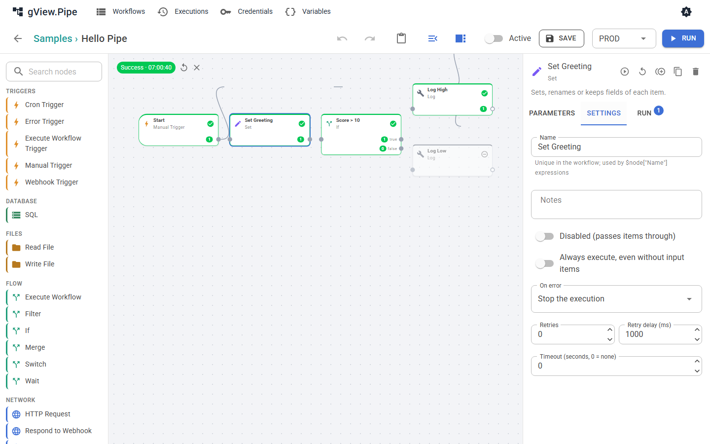
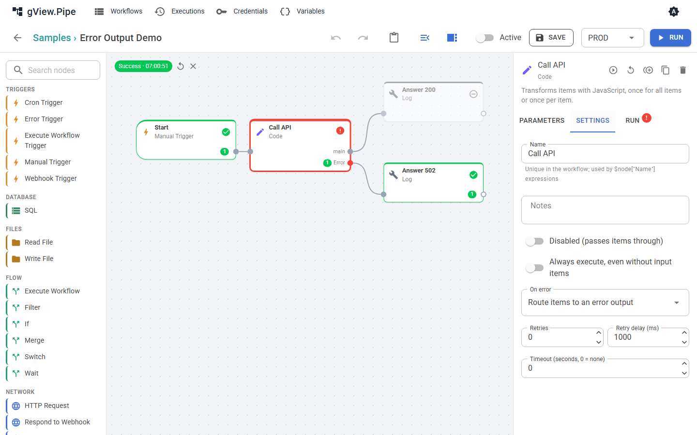

# Error handling

A node can fail: a script exits with a non-zero code, an HTTP call returns an error, a database is down. What happens next is decided per node, and per workflow by an optional error workflow.

## Node settings

Open a node and switch to the **Settings** tab.



| Setting | Meaning |
|---|---|
| Retries, Retry delay (ms) | The node is run again after a failure, up to this many times. |
| Backoff, Max delay (ms) | **Fixed delay** waits the same time before every retry. **Exponential** doubles it after every failed attempt (1 s, 2 s, 4 s, …), up to the max delay (0 = no limit). Shown when Retries is above 0. |
| Timeout (seconds) | The node is canceled after this time. 0 means no timeout. |
| **On error** | What the workflow does when the node still fails (see below). |

### On error

| Mode | What happens | Run status |
|---|---|---|
| **Stop the execution** (default) | The run is canceled. Nodes after the failed one never run. | **Error** |
| **Continue with the input items** | The error is recorded on the node, and the node passes its input items on its normal output (a script node passes its results, for example the exit code). The workflow goes on. | Success |
| **Route items to an error output** | The node gets a second output port, `error`. The items go there instead of the normal output, each with an `error` field `{ "message": …, "type": … }`. The normal output stays empty. | Success |



A node whose inputs are all empty is skipped, and so are the nodes after it. That is what makes the error output useful: connect one branch to the normal output and another to the `error` output. Only the branch that receives items runs.

!!! note
    With *Continue* or *Error output*, the run counts as **successful**. That has two consequences: the [error workflow](#error-workflows) is *not* started, and a webhook caller does not get a `500` unless you send one yourself.

## Error workflows

An error workflow is a normal workflow that starts with an **Error Trigger**. Choose it in the workflow panel of the failing workflow (**Error workflow**), for all workflows of a group in the group dialog, or for the whole instance in the [configuration](../admin-guide/configuration.md) (`Pipe:ErrorWorkflowId`). A workflow uses the first one set on workflow → group → instance; **None** on the workflow switches it off.

- It runs when a run of the workflow fails and was started by a trigger (cron, webhook) or is a [replay](executions.md#replay). Runs you start by hand in the editor don't start it.
- A failing **sub-workflow** doesn't start it: its caller fails too and reports it, with the sub-workflow in `subWorkflow`. If the caller catches the failure (*Continue* or *Error output* on Execute Workflow), nothing is reported.
- It receives one item that describes the failed run, for example to send a mail with the name of the workflow and the failed node:

    ```json
    { "workflow": { "id": "…", "name": "…" },
      "execution": { "id": "…", "mode": "…", "environment": "…", "startedAt": "…", "error": "…", "url": "…" },
      "node": { "id": "…", "name": "…", "error": "…" },
      "subWorkflow": { "id": "…", "name": "…", "executionId": "…", "error": "…", "node": { … } },
      "suppressed": 0 }
    ```

    Use it in expressions, for example `{{ $json.workflow.name }}` and `{{ $json.execution.error }}`. `url` links to the failed run when `Pipe:PublicUrl` is configured; `subWorkflow` is only there when a sub-workflow failed.
- **Throttle minutes** on the Error Trigger (default 15) starts it at most once in that time per failed workflow. Failures in between are counted in `suppressed` of the next run. Set 0 to report every failure.
- A failure of the error workflow itself is only written to the application log. A workflow is never its own error workflow.
- It does **not** change the result of the failed run. The run stays **Error**.

The samples **Error Mail**, **Error Teams** and **Error Slack** send notifications, **Error Alerts** writes to the log; see [Failure notifications](notifications.md).

## Answering a webhook after a failure

A webhook that waits for a Respond to Webhook node ([Triggers and webhooks](triggers.md#respond-to-webhook)) gets `500` when the run fails, because the Respond node is never reached. The error workflow doesn't help here: it runs separately and can't answer the call.

To control the answer, handle the error inside the workflow:

1. Set **On error** of the node that can fail to **Route items to an error output**.
2. Connect the normal output to a **Respond to Webhook** node with status `200`.
3. Connect the `error` output to a second **Respond to Webhook** node. Choose the status and the body yourself, for example status `502` with *Custom body* `{{ { error: $json.error.message } }}`.
4. Optional: put a **Send Email** node (or a **Log** node) on the `error` branch before the Respond node, to be notified.

Because the branch that gets no items is skipped, exactly one of the two Respond nodes runs.

!!! tip
    With **Continue with the input items** you can keep one Respond node. Test the result in the node after the one that can fail (for example with an **If** node that checks the exit code) and switch the status code with an expression.

If you want both a clean answer *and* the error workflow, send the notification from the `error` branch, as in step 4. The error workflow only starts for runs that end with **Error**.

## Finding out what failed

- In the editor, a failed node is shown with a red frame and an error badge. Its **Run** tab shows the input, the output and the log, including the error message.
- Webhook answers with `500` contain the `executionId`. Open that execution in the history.
- Scripts: a non-zero exit code or an output line matching the error pattern fails the node. The output of the script is in the node's log.
