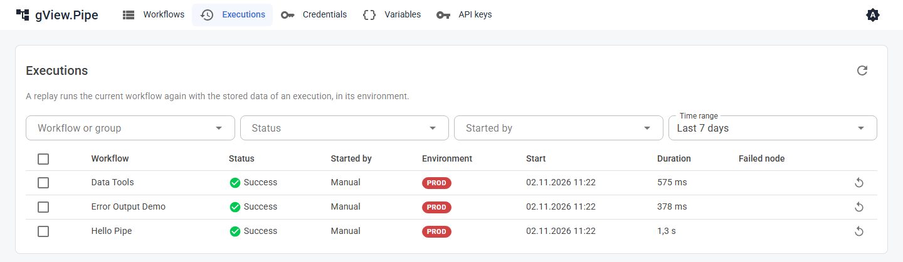

# Executions

An **execution** is one run of a workflow, started by the editor, a trigger or another workflow. gView.Pipe records every execution with what each node received, produced and logged.

## Running now

The start page lists every run in progress, whatever started it (the editor, Cron, a webhook or a sub-workflow). Each entry shows the workflow, its current node and the latest output line. The top bar shows **n running**.

Click a run to **watch** it in the editor, live. In the editor you can also **stop** it. Runs started by a webhook continue even when the caller disconnects, so stopping is the way to end one early.

!!! note
    The list shows runs of this app instance. A finished run stays visible for a minute.

## History

The workflow panel of the editor (select no node) lists the **executions** of the workflow, newest first, with status, start time, [environment](variables.md), how it was started (Manual, Trigger for Cron and Webhook, Sub-workflow, Error workflow, Replay, API with the name of the [API key](../admin-guide/api.md)) and the duration. The field above the list filters by environment. The last 50 are kept, unless the workflow panel (**Executions kept**, **Days kept**) or the [configuration](../admin-guide/configuration.md) says otherwise.

Click an execution to open it on the canvas: every node shows its state and counts, and you can open each node's **Run** tab to see the input, output and logs of that run. A note appears when the workflow was changed since the run, because some nodes may no longer exist.

| Status | Meaning |
|---|---|
| Success | The run finished. Individual nodes may have failed if they use *Continue* or *Error output*. |
| Error | A node failed with *Stop the execution*. The failed node is marked red. |
| Canceled | Someone stopped the run. |
| Running | Still in progress. |

Click the **x** next to the result chip above the canvas to clear the display and go back to the plain workflow.

## All executions

**Executions** in the navigation lists the executions of all workflows, newest first: workflow, status, how it was started, environment, start, duration and the failed node. Filter by workflow or group, status, how it was started and time range (the last 7 days at first); **Load more** fetches older ones. Click a row to open the execution in the editor.

## Replay

A **replay** runs a stored execution again, for example after you fixed the cause of a failure:

- It runs the **saved, current** workflow, not the version of the original run.
- It uses the stored data of the original run and runs in its **environment**.
- It behaves like a triggered run: pinned data is ignored, and the [error workflow](error-handling.md) starts when it fails.
- It is listed as started by **Replay** and marked with the replay icon.

Where you start it:

| Where | What runs again |
|---|---|
| Replay button of a row, or several selected rows on the Executions page | The whole workflow, with the trigger output of the original run. Several replays run one after the other, oldest first. |
| **Replay from failed node** on the Executions page | Failed executions from their failed node, the others from the start. |
| Replay icon next to the result chip in the editor | The whole workflow; the red icon next to it replays from the failed node. |
| **Replay from here** in the toolbar of a selected node, while a run is shown | This node and everything after it. All other nodes take their outputs from the shown run. |

A replay waits until the workflow has a free run slot (**Max concurrent runs**) instead of being skipped. In the editor, save your changes first: the replay runs the saved workflow.

!!! warning
    Executions stored without item data (**Save item data of executions** switched off) can't be replayed. Files of a run (binary data) are not kept after it ends: a node that reads such a file in a replay fails.

## Sensitive data

Items of an execution are stored in the history, so they stay readable for everyone who can use the editor. Switch off **Save item data of executions** in the workflow panel if items contain sensitive data: then only statuses, counts and logs are stored. Secrets from webhook headers (`Authorization`, `Cookie`) never reach the items.

## Executions and restarts

Running executions live in the memory of the app. When the app restarts, they end. A Wait node that is waiting loses its run. Finished executions are kept in files and survive a restart.
