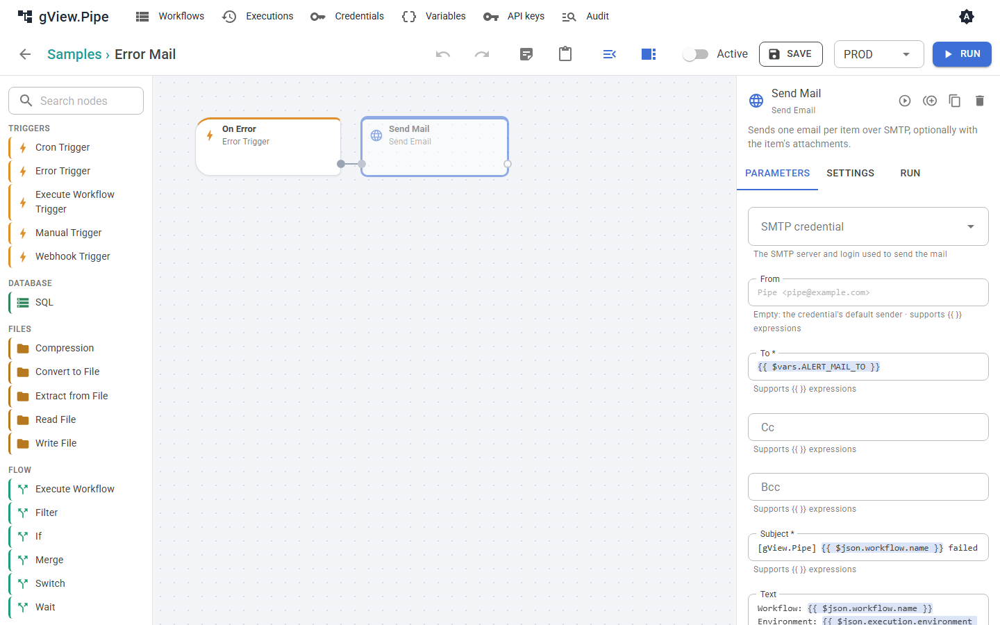

# Failure notifications

When a scheduled or webhook-triggered workflow fails, nobody is watching the editor. An [error workflow](error-handling.md#error-workflows) can send a message instead: a mail, a Teams post or a Slack message. The samples group contains one for each.

| Sample | Sends | Needs |
|---|---|---|
| **Error Mail** | a mail with workflow, environment, node, error and a link | an SMTP [credential](credentials.md) and the variable `ALERT_MAIL_TO` |
| **Error Teams** | an Adaptive Card to a Teams channel | the secret variable `ALERT_TEAMS_URL` |
| **Error Slack** | a message to a Slack channel | the secret variable `ALERT_SLACK_URL` |
| **Error Alerts** | a line in the application log | nothing |

## Setting up

1. Open the sample, for example **Error Mail**. Its sending node is **disabled** so that a fresh installation sends nothing.
2. Set what it needs:
    - **Error Mail:** choose the SMTP credential in the node *Send Mail*, and define the variable `ALERT_MAIL_TO` (one or more addresses, separated by commas) on the [Variables](variables.md) page. Different values per environment are possible, for example a team mailbox for `PROD`.
    - **Error Teams:** in Teams, add the workflow *Post to a channel when a webhook request is received* to the channel and copy its URL. Define it as the secret variable `ALERT_TEAMS_URL`.
    - **Error Slack:** create an incoming webhook in your Slack app and define its URL as the secret variable `ALERT_SLACK_URL`.
3. Enable the sending node (select it, **Settings**, switch off **Disabled**) and save.
4. Choose the error workflow where it should apply:
    - for one workflow: **Error workflow** in its workflow panel;
    - for a group: **Error workflow** in the group dialog (pencil on the group tile);
    - for all workflows: `Pipe:ErrorWorkflowId` in `pipe.config`, for example `"error-mail"` ([Configuration](../admin-guide/configuration.md)).

    A workflow uses the first one set on workflow → group → instance. **None** on a workflow switches notifications off for it, for example for a test workflow.
5. Ask the administrator to set `Pipe:PublicUrl` to the address users open the app at. Then the messages contain a link to the failed run.

Copy a sample rather than editing it when you need several variants, for example different recipients per group.

## How often messages are sent

The **Throttle minutes** of the Error Trigger (default 15) limit the messages per failed workflow: after a message, further failures of the same workflow are only counted for that time. The next message says how many there were (`suppressed`). A workflow that fails every minute therefore sends one message per quarter of an hour, not 15. Set 0 to get every failure.

Other things that keep the noise down:

- Runs you start in the editor never send messages.
- A failing sub-workflow is reported once, by the workflow that called it; the message names the sub-workflow and its failed node.
- A node with *Continue* or *Error output* doesn't fail the run, so it isn't reported. Send a message from its `error` branch if you need one ([Error handling](error-handling.md)).

## Back to normal

An alarm should also end. Put a **Recovery Trigger** into the same workflow as the Error Trigger and connect it to a message, like the second branch of the three samples (disabled until you set them up). It starts when a workflow that failed runs successfully again.

- It only reports a recovery when a failure was reported before: if the throttle swallowed all failures, or no error workflow applied, nobody hears about the recovery either.
- Only runs by trigger, [replay](executions.md#replay) or the API count. A run you start in the editor neither starts nor ends a failure.
- The state is kept on disk (`data/health`), so it survives a restart.
- The item is `{ workflow, execution, failedSince, failedExecution, failures }`; `execution.url` and `failedExecution.url` link to the runs with `Pipe:PublicUrl`.

| Expression | Value |
|---|---|
| `{{ $json.failedSince }}` | start of the first failed run |
| `{{ $json.failures }}` | failed runs since then, reported or not |

## Trying it out

Start the developer containers with Mailpit (`ADD_MAILPIT` in the AppHost, see the [Developer Guide](../developer-guide/index.md)) and create an SMTP credential for `localhost`, port `1025`, without TLS. Set up **Error Mail** with it, make a workflow with a Cron or Webhook Trigger fail (for example a Code node with `throw new Error('test')`), and let it run by its trigger or [replay](executions.md#replay) a failed run. The mail appears at http://localhost:8025.

## Writing your own

Any workflow that starts with an **Error Trigger** is an error workflow. Its item is described in [Error handling](error-handling.md#error-workflows). Useful expressions:

| Expression | Value |
|---|---|
| `{{ $json.workflow.name }}` | name of the failed workflow |
| `{{ $json.execution.environment }}` | environment of the run, for example `PROD` |
| `{{ $json.node?.name ?? '-' }}` | the failed node, if known |
| `{{ $json.execution.error }}` | the error message |
| `{{ $json.execution.url ?? '' }}` | link to the run (with `Pipe:PublicUrl`) |
| `{{ $json.suppressed }}` | failures not reported since the last message |
