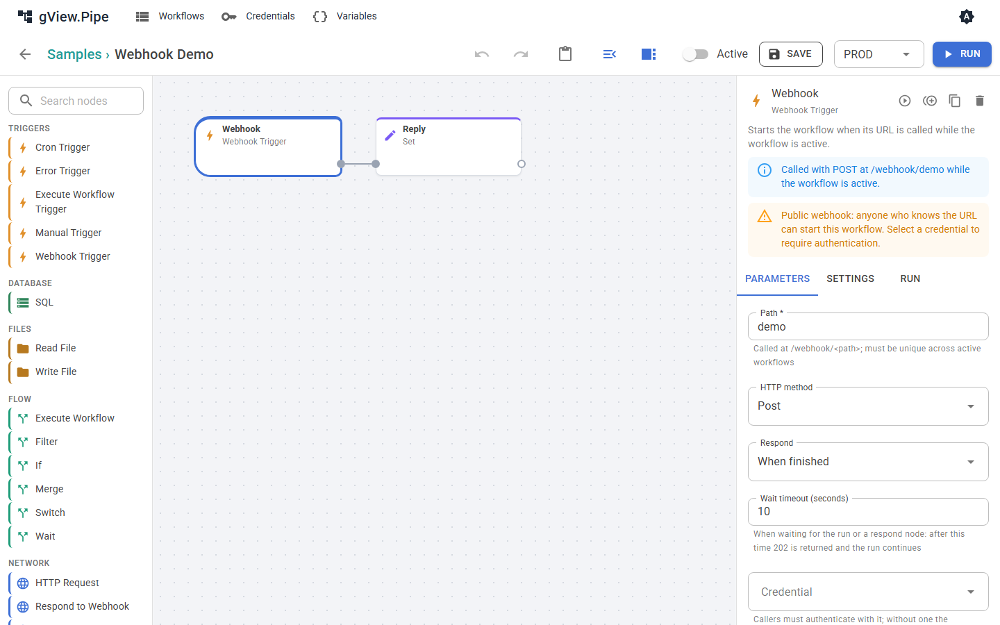

# Triggers and webhooks

A trigger is the first node of a workflow. It decides when the workflow starts.

| Trigger | Starts the workflow |
|---|---|
| Manual Trigger | When you run it in the editor. |
| Cron Trigger | On a schedule (5 or 6 field cron expression), while the workflow is active. |
| Webhook Trigger | When its URL is called, while the workflow is active. |
| Execute Workflow Trigger | When another workflow calls this one with the Execute Workflow node. |
| Error Trigger | When a run of another workflow fails (see [Error handling](error-handling.md)). |

## Webhook Trigger

A Webhook Trigger makes the workflow callable at

```
<server address>/webhook/<path>
```

The editor shows the exact URL as a hint next to the parameters.



| Parameter | Meaning |
|---|---|
| Path | Letters, digits, `_`, `-` and `/`, lower case. Must be unique across all active workflows. A random path is suggested for a new node. |
| HTTP method | `POST` by default, or `GET`, `PUT`, `PATCH`, `DELETE`, or any method. |
| Respond | When and how the caller gets an answer (see below). |
| Wait timeout (seconds) | How long the caller waits in the modes that wait. After that the caller gets `202` and the run goes on. |
| Credential | Basic Auth, Bearer Token or API Key Header. Without one, **anyone who knows the URL can start the workflow**. |

!!! warning
    A webhook without a credential is public. The editor warns you about it.

### The request as an item

The trigger turns the call into one item:

```json
{
  "method": "POST",
  "path": "orders/new",
  "query": { "id": "7" },
  "headers": { "content-type": "application/json" },
  "body": { "customer": "ACME" },
  "receivedAt": "2026-11-01T10:15:00.0000000+00:00"
}
```

- A JSON body (`Content-Type` contains `json`) becomes an object in `body`. Form fields become an object. Any other body is text.
- Uploaded files become binary attachments of the item.
- The headers `authorization`, `proxy-authorization`, `cookie` and the API key header are removed, so secrets never end up in the execution history.
- Bodies larger than 10 MB are rejected with `413`.

### Answering the caller

The **Respond** parameter decides what the caller receives.

| Mode | The caller gets |
|---|---|
| **Immediately** | `202` with `{ "executionId": …, "status": "started" }` straight away. The workflow runs in the background. Whether it succeeds is not reported to the caller. |
| **When finished** | The items of the node that finished last: one item as an object, several as an array. If the run fails, the caller gets `500`. |
| **Using respond node** | The answer of a **Respond to Webhook** node in the workflow. |

In both waiting modes the caller gets `202` with `"status": "running"` when the run takes longer than the timeout. The run is never canceled when the caller disconnects.

### Respond to Webhook

The Respond to Webhook node sends the answer in the mode *Using respond node*. It lets you choose the status code, headers and body:

| Parameter | Meaning |
|---|---|
| Respond with | The first item, all items as an array, a custom body or no body. |
| Body | For *custom body*: JSON or an expression, evaluated against the first item. |
| Status code | 100 to 599. Supports expressions. |
| Headers | Optional response headers. A text body with a non-JSON `Content-Type` (for example `text/html`) is sent as is. |

The items pass through the node, so the workflow can continue after it has answered.

!!! important
    The answer only exists if a Respond to Webhook node **runs**. When a node before it fails with the error mode *Stop the execution*, the run ends there, the Respond node never runs, and the caller gets `500` with the error message. To answer in a failure case too, see [Answering a webhook after a failure](error-handling.md#answering-a-webhook-after-a-failure).

### Status codes

| Code | Reason |
|---|---|
| 200 | Answer of the workflow (*When finished*) or of a Respond to Webhook node. |
| 202 | Started (*Immediately*), or the timeout passed while the run goes on. |
| 400 | The header `X-Pipe-Environment` names an environment the workflow doesn't allow. |
| 401 | The credential is missing or wrong. |
| 404 | No active webhook at this path. |
| 405 | The method does not match the trigger. |
| 413 | The body is too large. |
| 429 | The workflow is already running and its limit of concurrent runs is reached (default 1). |
| 500 | The run failed, or ended without reaching a Respond to Webhook node. The body contains the error and the execution id. |

The `500` body looks like `{ "error": "…", "executionId": "…" }`. Look the execution id up in the execution history to see which node failed.

### Choosing the environment

A webhook run uses the effective environment of the workflow (see [Variables and environments](variables.md)). To let callers choose another one, for example to test a system against the test database, list it under **Webhook callers may choose** in the workflow panel. The caller then sends the header:

```
X-Pipe-Environment: TEST
```

An environment that isn't listed is rejected with `400`, never silently replaced. The header is checked after the credential, so a caller without access learns nothing about the environments.

### Try it

```bash
curl -i -X POST http://localhost:5240/webhook/demo -H "Content-Type: application/json" -d '{"name":"Ada"}'
```

In Windows PowerShell, `Invoke-RestMethod` hides the body of an error answer. Use `curl.exe -i` (with `-k` for the development certificate on `https://localhost:7240`) to see the status code and the body.
